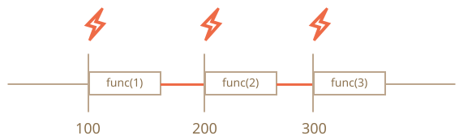
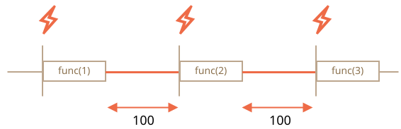

# การตั้งเวลา: setTimeout และ setInterval

บางครั้งเราต้องการให้ฟังก์ชัน (function) ทำงานในอีกสักพัก แทนที่จะเรียกใช้ทันที การกำหนดว่าจะเรียกฟังก์ชันเมื่อไหร่แบบนี้เรียกว่า *การตั้งเวลาเรียกฟังก์ชัน (scheduling a call)*

เราทำได้ด้วยเมธอด (method) สองตัว:

- `setTimeout` เรียกฟังก์ชัน **ครั้งเดียว** หลังจากรอตามเวลาที่กำหนด
- `setInterval` รอตามเวลาที่กำหนดก่อนเรียกฟังก์ชันครั้งแรก แล้วเรียก **ซ้ำไปเรื่อย ๆ** ตามช่วงเวลานั้น

เมธอดทั้งสองไม่ได้เป็นส่วนหนึ่งของข้อกำหนดภาษา JavaScript โดยตรง แต่สภาพแวดล้อมที่ใช้รัน JavaScript ส่วนใหญ่มีระบบคอยจัดเวลาเรียกฟังก์ชัน หรือ scheduler ให้ใช้งานอยู่แล้ว ทั้งเบราว์เซอร์ (browser) และ Node.js ก็รองรับเมธอดเหล่านี้

## setTimeout

ตัวอย่างในบทนี้ใช้ `setTimeout` ของเบราว์เซอร์ ซึ่งมีรูปแบบการเรียกดังนี้:

```js
let timerId = setTimeout(func|code, [delay], [arg1], [arg2], ...)
```

พารามิเตอร์ (parameter) แต่ละตัวมีความหมายดังนี้:

`func|code`
: ฟังก์ชันที่ต้องการให้ทำงาน หรือสตริง (string) ที่มีโค้ดอยู่ข้างใน
โดยทั่วไปควรส่งฟังก์ชันเข้าไป การส่งโค้ดเป็นสตริงเป็นรูปแบบที่รองรับมาตั้งแต่เดิม แต่ไม่แนะนำให้ใช้

`delay`
: เวลาที่ต้องรอก่อนเรียกฟังก์ชัน หน่วยเป็นมิลลิวินาที (1000 ms = 1 วินาที) ถ้าไม่ระบุจะใช้ค่า 0

`arg1`, `arg2`...
: อาร์กิวเมนต์ (argument) ที่จะส่งต่อให้ฟังก์ชันเมื่อถึงเวลาเรียก

ตัวอย่างนี้จะเรียก `sayHi()` หลังจากผ่านไป 1 วินาที:

```js run
function sayHi() {
  alert('Hello');
}

*!*
setTimeout(sayHi, 1000);
*/!*
```

ถ้าฟังก์ชันต้องรับอาร์กิวเมนต์ด้วย ให้ใส่ค่าต่อจากเวลาหน่วง ในตัวอย่างนี้ `sayHi` จะได้รับ `"Hello"` และ `"John"`:

```js run
function sayHi(phrase, who) {
  alert( phrase + ', ' + who );
}

*!*
setTimeout(sayHi, 1000, "Hello", "John"); // Hello, John
*/!*
```

ถ้าส่งสตริงเป็นอาร์กิวเมนต์ตัวแรก ระบบจะนำโค้ดในสตริงนั้นไปทำงานเมื่อถึงเวลา

ดังนั้น ในเบราว์เซอร์จึงเขียนแบบนี้ได้เช่นกัน:

```js run no-beautify
setTimeout("alert('Hello')", 1000);
```

แต่ควรส่งฟังก์ชันแทนสตริง เช่น เขียนด้วย arrow function แบบนี้:

```js run no-beautify
setTimeout(() => alert('Hello'), 1000);
```

````smart header="ส่งฟังก์ชันเข้าไป ไม่ใช่เรียกฟังก์ชัน"
จุดที่มักสับสนคือการใส่วงเล็บ `()` ต่อท้ายชื่อฟังก์ชัน:

```js
// ผิด!
setTimeout(sayHi(), 1000);
```
เราต้องส่ง `sayHi` ซึ่งเป็นการอ้างอิง (reference) ถึงฟังก์ชันให้ `setTimeout` เก็บไว้เรียกภายหลัง แต่การเขียน `sayHi()` จะเรียกฟังก์ชันทันที แล้วส่ง *ค่าที่ฟังก์ชันคืนมา* ให้ `setTimeout` แทน

ในตัวอย่างนี้ `sayHi` ไม่มี `return` จึงคืนค่า `undefined` ผลคือ `sayHi` ทำงานไปแล้ว และไม่ได้ถูกตั้งเวลาให้ทำงานอีกครั้ง
````

### ยกเลิกด้วย clearTimeout

เมื่อเรียก `setTimeout` เราจะได้ค่าที่ใช้ระบุตัวจับเวลา (timer identifier) กลับมา ในตัวอย่างเราเก็บค่านี้ไว้ในตัวแปร (variable) ชื่อ `timerId` เพื่อนำไปยกเลิกการเรียกที่ตั้งเวลาไว้

ยกเลิกได้ด้วยการส่ง `timerId` ให้ `clearTimeout`:

```js
let timerId = setTimeout(...);
clearTimeout(timerId);
```

โค้ดด้านล่างตั้งเวลาไว้แล้วเรียก `clearTimeout` เพื่อยกเลิก จึงไม่มีข้อความ `"never happens"` แสดงขึ้นมา ส่วน `alert(timerId)` ทั้งสองครั้งยังแสดงค่าเดิม:

```js run no-beautify
let timerId = setTimeout(() => alert("never happens"), 1000);
alert(timerId); // ตัวระบุ timer

clearTimeout(timerId);
alert(timerId); // ตัวระบุเดิม (ไม่ได้กลายเป็น null หลังยกเลิก)
```

จากผลของ `alert` จะเห็นว่าในเบราว์เซอร์ ค่าที่ใช้ระบุตัวจับเวลาเป็นตัวเลข แต่สภาพแวดล้อมอื่นอาจคืนค่าในรูปแบบอื่น เช่น Node.js คืนออบเจ็กต์ (object) ที่มีเมธอดสำหรับจัดการตัวจับเวลาเพิ่มเติม

รูปแบบที่ต่างกันนี้ไม่ขัดกับข้อกำหนดภาษา เพราะเมธอดเหล่านี้ไม่มีข้อกำหนดกลางที่ใช้ร่วมกันทุกสภาพแวดล้อม

ส่วนพฤติกรรมของตัวจับเวลาในเบราว์เซอร์มีข้อกำหนดอยู่ใน [หัวข้อ Timers ของ HTML Living Standard](https://html.spec.whatwg.org/multipage/timers-and-user-prompts.html#timers)

## setInterval

เมธอด `setInterval` มีรูปแบบการเรียกเหมือน `setTimeout`:

```js
let timerId = setInterval(func|code, [delay], [arg1], [arg2], ...)
```

อาร์กิวเมนต์ทุกตัวมีความหมายเหมือนเดิม แต่ `setInterval` จะเรียกฟังก์ชัน **ซ้ำตามช่วงเวลาที่กำหนด** ขณะที่ `setTimeout` เรียกเพียงครั้งเดียว

หยุดการเรียกซ้ำได้ด้วย `clearInterval(timerId)`

ตัวอย่างนี้ตั้งให้แสดง `tick` ทุก 2 วินาที และเมื่อผ่านไป 5 วินาที จะยกเลิกการเรียกซ้ำพร้อมแสดง `stop`:

```js run
// ทำซ้ำทุก 2 วินาที
let timerId = setInterval(() => alert('tick'), 2000);

// หยุดหลังจาก 5 วินาที
setTimeout(() => { clearInterval(timerId); alert('stop'); }, 5000);
```

```smart header="เวลายังเดินต่อขณะที่ `alert` แสดงอยู่"
ในเบราว์เซอร์ส่วนใหญ่ รวมถึง Chrome และ Firefox เวลาของตัวจับเวลายังเดินต่อระหว่างที่เปิดกล่อง `alert/confirm/prompt` ค้างไว้

ถ้ารันโค้ดด้านบนแล้วเปิด `alert` ค้างไว้จนถึงเวลาเรียกครั้งถัดไป เมื่อปิดกล่องเดิม กล่องถัดไปก็จะแสดงขึ้นมาทันที ช่วงที่รอจากปิดกล่องหนึ่งจนอีกกล่องเปิดจึงอาจสั้นกว่า 2 วินาที
```

## setTimeout แบบซ้อน

ถ้าต้องการให้ฟังก์ชันทำงานซ้ำตามเวลา เราเลือกได้สองวิธี

วิธีแรกคือใช้ `setInterval` ส่วนอีกวิธีคือเรียก `setTimeout` ซ้อนอยู่ในฟังก์ชันที่ตั้งเวลาไว้ เพื่อให้ฟังก์ชันนั้นตั้งเวลาเรียกตัวเองรอบถัดไป:

```js
/** แทนที่จะใช้:
let timerId = setInterval(() => alert('tick'), 2000);
*/

let timerId = setTimeout(function tick() {
  alert('tick');
*!*
  timerId = setTimeout(tick, 2000); // (*)
*/!*
}, 2000);
```

เมื่อ `tick` ทำงานมาถึงบรรทัด `(*)` ก็จะตั้งเวลาให้เรียก `tick` อีกครั้งในอีก 2 วินาที การตั้งเวลารอบใหม่จึงเกิดขึ้นตอนท้ายของรอบปัจจุบัน

วิธีนี้ยืดหยุ่นกว่า `setInterval` เพราะเราเลือกเวลาของรอบถัดไปได้ตามผลการทำงานของรอบปัจจุบัน

สมมติว่าโปรแกรมต้องส่งคำขอข้อมูลไปยังเซิร์ฟเวอร์ (server) ทุก 5 วินาที แต่ถ้าเซิร์ฟเวอร์ทำงานหนักจนรับคำขอไม่ไหว เราต้องการเพิ่มเวลารอก่อนส่งครั้งถัดไปเป็น 10, 20, 40 วินาทีตามลำดับ

เราเขียนแนวคิดด้วยรหัสเทียม (pseudocode) ได้ดังนี้ โค้ดนี้ใช้แสดงลำดับการทำงาน ยังนำไปรันโดยตรงไม่ได้:
```js
let delay = 5000;

let timerId = setTimeout(function request() {
  ...send request...

  if (request failed due to server overload) {
    // ยืดช่วงเวลาสำหรับการเรียกครั้งถัดไป
    delay *= 2;
  }

  timerId = setTimeout(request, delay);

}, delay);
```


ถ้าฟังก์ชันที่ตั้งเวลาไว้ต้องประมวลผลหนัก เราก็วัดเวลาที่ฟังก์ชันใช้ทำงาน แล้วนำมาปรับว่าจะเรียกรอบถัดไปเร็วขึ้นหรือช้าลงได้ด้วย

**`setTimeout` แบบซ้อนช่วยให้กำหนดช่วงพักระหว่างการทำงานแต่ละรอบได้แม่นยำกว่า `setInterval`**

ลองเปรียบเทียบโค้ดสองแบบนี้ แบบแรกใช้ `setInterval`:

```js
let i = 1;
setInterval(function() {
  func(i++);
}, 100);
```

แบบที่สองใช้ `setTimeout` แบบซ้อน:

```js
let i = 1;
setTimeout(function run() {
  func(i++);
  setTimeout(run, 100);
}, 100);
```

เมื่อใช้ `setInterval` ระบบจะตั้งเวลาเรียก `func(i++)` ทุก 100 มิลลิวินาที:



จุดที่ควรสังเกตคือเวลาตั้งแต่ `func` ทำงานจบ จนเริ่มทำงานรอบถัดไป

**ในภาพของ `setInterval` ช่วงพักหลัง `func` จบจะ *สั้นกว่า* 100 มิลลิวินาทีที่กำหนดไว้**

เพราะเวลาที่ `func` ใช้ทำงานนับรวมอยู่ในช่วง 100 มิลลิวินาทีนั้นด้วย ไม่ได้เริ่มนับใหม่หลังฟังก์ชันทำงานจบ

ถ้า `func` ใช้เวลานานกว่าที่คาดไว้จนเกิน 100 มิลลิวินาที จะเกิดอะไรขึ้น?

JavaScript จะรอให้ `func` ทำงานเสร็จก่อน แล้วตรวจว่าถึงเวลาเรียกรอบถัดไปหรือยัง ถ้าถึงเวลาแล้วก็อาจเรียกอีกครั้ง *ทันที*

ถ้าแต่ละรอบใช้เวลานานกว่า `delay` เสมอ ฟังก์ชันก็อาจทำงานต่อกันไปโดยไม่มีช่วงพักเลย

ส่วน `setTimeout` แบบซ้อนจะนับเวลาแบบนี้:



**`setTimeout` แบบซ้อนทำให้มีช่วงพักอย่างน้อยตามเวลาที่กำหนด (100 มิลลิวินาทีในตัวอย่างนี้) นับจากรอบหนึ่งจบจนรอบถัดไปเริ่ม**

เพราะเราเพิ่งตั้งเวลาเรียกรอบใหม่ตอนท้ายของรอบก่อน ระบบจึงเริ่มนับเวลารอจากตรงนั้น

````smart header="การเก็บขยะ (garbage collection) กับคอลแบ็ก (callback) ของ setInterval/setTimeout"
ฟังก์ชันที่เราส่งให้ `setInterval/setTimeout` เพื่อเรียกภายหลังคือคอลแบ็ก ระบบจะเก็บการอ้างอิงถึงฟังก์ชันนั้นไว้ใน scheduler จึงยังไม่ลบฟังก์ชันออกจากหน่วยความจำ (memory) ระหว่างการเก็บขยะ แม้ส่วนอื่นของโปรแกรมจะไม่ได้อ้างอิงถึงฟังก์ชันนั้นแล้วก็ตาม

```js
// ฟังก์ชันจะอยู่ในหน่วยความจำจนกว่า scheduler จะเรียก
setTimeout(function() {...}, 100);
```

สำหรับ `setInterval` ฟังก์ชันจะอยู่ในหน่วยความจำจนกว่าจะเรียก `clearInterval`

การเก็บฟังก์ชันไว้ยังมีผลต่อส่วนอื่นด้วย ฟังก์ชันอ้างอิงถึง Lexical Environment ชั้นนอก ซึ่งเก็บตัวแปรภายนอกที่ฟังก์ชันเข้าถึงได้ ตัวแปรเหล่านั้นจึงยังอยู่ในหน่วยความจำเช่นกัน และอาจใช้พื้นที่มากกว่าตัวฟังก์ชันเสียอีก ดังนั้น เมื่อไม่ต้องการให้ฟังก์ชันที่ตั้งเวลาไว้ทำงานแล้ว ควรยกเลิก แม้ตัวฟังก์ชันจะมีขนาดเล็กก็ตาม
````

## setTimeout ที่กำหนดเวลาหน่วงเป็นศูนย์

เรายังใช้ `setTimeout(func, 0)` หรือเขียนสั้น ๆ ว่า `setTimeout(func)` ได้ด้วย

การกำหนดเวลาหน่วงเป็นศูนย์หมายถึงให้เรียก `func` เร็วที่สุดเท่าที่ทำได้ แต่ scheduler ต้องรอให้สคริปต์ (script) ที่กำลังทำงานอยู่จบก่อน

ฟังก์ชันจึงถูกตั้งเวลาให้ทำงานต่อจากสคริปต์ปัจจุบัน ไม่ได้แทรกเข้ามาระหว่างที่สคริปต์ยังทำงานอยู่

ตัวอย่างนี้จะแสดง `Hello` ก่อน แล้วจึงแสดง `World`:

```js run
setTimeout(() => alert("World"));

alert("Hello");
```

บรรทัดแรกตั้งเวลาให้เรียกฟังก์ชันที่แสดง `World` โดยไม่กำหนดเวลารอ แต่ยังไม่เรียกทันที โค้ดจึงทำงานต่อมาที่ `alert("Hello")` ก่อน เมื่อสคริปต์จบแล้ว ฟังก์ชันที่ตั้งเวลาไว้จึงทำงานและแสดง `World`

การใช้ `setTimeout` แบบนี้ในเบราว์เซอร์ยังมีรายละเอียดอื่นที่เราจะเรียนกันในบท <info:event-loop>

````smart header="ตั้งเวลาหน่วงเป็นศูนย์ แต่เวลาที่รอจริงอาจไม่ใช่ศูนย์"
เบราว์เซอร์จำกัดความถี่ของตัวจับเวลาที่เรียกต่อกันเป็นทอด ๆ โดย [HTML Living Standard](https://html.spec.whatwg.org/multipage/timers-and-user-prompts.html#timers) กำหนดว่า เมื่อระดับการเรียกซ้อนเกิน 5 และเวลาหน่วงน้อยกว่า 4 มิลลิวินาที ให้ใช้เวลาหน่วง 4 มิลลิวินาทีแทน

ลองดูตัวอย่างนี้ `setTimeout` จะตั้งเวลาเรียก `run` ซ้ำโดยไม่ระบุเวลาหน่วง แต่ละครั้งจะเก็บเวลาที่ผ่านไปนับจาก `start` ไว้ในอาร์เรย์ (array) ชื่อ `times` ค่าที่เก็บจึงเป็นเวลาสะสมจากจุดเริ่มต้น ถ้าต้องการรู้ว่าระหว่างสองครั้งรอนานเท่าไหร่ ให้นำค่าถัดไปลบค่าก่อนหน้า:

```js run
let start = Date.now();
let times = [];

setTimeout(function run() {
  times.push(Date.now() - start); // บันทึกเวลาที่ผ่านไปนับจาก start

  if (start + 100 < Date.now()) alert(times); // แสดงเวลาที่บันทึกไว้เมื่อผ่านไปเกิน 100ms
  else setTimeout(run); // ถ้ายังไม่ถึง ตั้งเวลาเรียกใหม่
});

// ตัวอย่างผลลัพธ์:
// 0,0,0,0,0,0,5,10,14,18,23,27,32,36,41,45,50,55,59,64,68,73,77,82,86,91,95,100,104
```

การเรียกช่วงแรก ๆ เกิดขึ้นติดกันได้ เพราะยังไม่ถึงระดับที่ต้องใช้เวลาหน่วงขั้นต่ำ ส่วนช่วงหลังของตัวอย่าง ค่าที่บันทึกจะเพิ่มครั้งละ 4 หรือ 5 มิลลิวินาที แสดงว่าเริ่มมีการหน่วงตามข้อจำกัดขั้นต่ำ 4 มิลลิวินาทีแล้ว ค่าที่ได้จริงอาจต่างกันในแต่ละครั้งที่รัน

ข้อจำกัดเดียวกันนี้ใช้กับ `setInterval` ด้วย แม้ `setInterval(f)` จะไม่ได้ระบุเวลาหน่วง แต่หลังจากเรียกซ้ำไปหลายรอบ ก็จะใช้เวลาหน่วงอย่างน้อย 4 มิลลิวินาทีเช่นกัน

ข้อจำกัดนี้มีมานานแล้ว และสคริปต์จำนวนมากอาศัยพฤติกรรมนี้อยู่ จึงยังต้องรักษาไว้

ข้อจำกัดเรื่องการเรียกซ้อนนี้เป็นข้อกำหนดของเบราว์เซอร์ JavaScript ฝั่งเซิร์ฟเวอร์ไม่ได้ใช้ข้อจำกัดเดียวกัน และยังมีวิธีอื่นสำหรับนัดให้งานทำต่อโดยเร็ว เช่น [`setImmediate` ของ Node.js](https://nodejs.org/api/timers.html#timers_setimmediate_callback_args)
````

## สรุป

- `setTimeout(func, delay, ...args)` ตั้งเวลาเรียก `func` ครั้งเดียวหลังจากรอ `delay` มิลลิวินาที ส่วน `setInterval(func, delay, ...args)` เรียกซ้ำตามช่วงเวลานั้น
- ยกเลิกการเรียกที่ตั้งเวลาไว้ด้วย `clearTimeout` หรือ `clearInterval` โดยส่งค่าที่ได้จาก `setTimeout` หรือ `setInterval` เข้าไป
- `setTimeout` แบบซ้อนยืดหยุ่นกว่า `setInterval` เพราะปรับเวลารอก่อนรอบถัดไปได้ และกำหนดช่วงพัก *ระหว่าง* การทำงานแต่ละรอบได้แม่นยำกว่า
- `setTimeout(func, 0)` หรือ `setTimeout(func)` ตั้งเวลาให้ฟังก์ชันทำงานเร็วที่สุดเท่าที่ทำได้ แต่ต้องรอให้สคริปต์ปัจจุบันจบก่อน
- เมื่อระดับการเรียกซ้อนของตัวจับเวลาเกิน 5 เบราว์เซอร์จะใช้เวลาหน่วงอย่างน้อย 4 มิลลิวินาที กฎนี้รวมถึงการเรียกซ้ำของ `setInterval` ด้วย และยังคงอยู่เพื่อรองรับพฤติกรรมที่สคริปต์เดิมอาศัยอยู่

เมธอดตั้งเวลาเหล่านี้ไม่ได้ *รับประกัน* ว่าฟังก์ชันจะทำงานตรงตามเวลาที่ระบุเสมอไป

ตัวจับเวลาในเบราว์เซอร์อาจทำงานช้าลงได้จากหลายสาเหตุ เช่น:
- หน่วยประมวลผล (CPU) กำลังทำงานหนัก
- หน้าเว็บอยู่ในแท็บเบื้องหลัง
- แล็ปท็อปอยู่ในโหมดประหยัดแบตเตอรี่

ปัจจัยเหล่านี้อาจทำให้เวลารอขั้นต่ำยาวขึ้น เช่น เป็น 300 หรือ 1000 มิลลิวินาที ทั้งนี้ขึ้นอยู่กับเบราว์เซอร์และการตั้งค่าประสิทธิภาพของระบบปฏิบัติการ (operating system)
