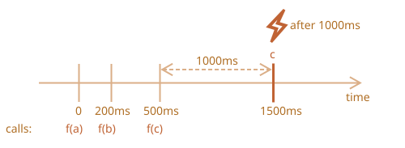

importance: 5

---

# Debounce decorator

Decorator `debounce(f, ms)` คืน wrapper หรือฟังก์ชัน (function) ที่ครอบการเรียก `f` โดยจะรอจนไม่มีใครเรียก wrapper เพิ่มเป็นเวลา `ms` มิลลิวินาที แล้วจึงเรียก `f` หนึ่งครั้งด้วยอาร์กิวเมนต์ (argument) จากการเรียกครั้งล่าสุด

หากมีการเรียกใหม่เข้ามาระหว่างรอ ก็ต้องเริ่มนับเวลารอจากการเรียกครั้งใหม่นั้น การเรียกที่มาติด ๆ กันจึงเหลือการทำงานจริงเพียงครั้งเดียวเมื่อเว้นช่วงนานพอ

สมมติว่าเราครอบฟังก์ชันเดิมด้วย `f = debounce(f, 1000)` แล้วเรียก wrapper ที่เวลา 0, 200 และ 500 มิลลิวินาที จากนั้นไม่มีการเรียกเพิ่ม

ตามลำดับเวลาในตัวอย่าง ฟังก์ชันเดิมจะทำงานครั้งเดียวที่ 1500 มิลลิวินาที ซึ่งห่างจากการเรียกครั้งสุดท้ายที่ 500 มิลลิวินาทีอยู่ 1000 มิลลิวินาที:



ฟังก์ชันเดิมจะได้รับอาร์กิวเมนต์จากการเรียกครั้งสุดท้ายเท่านั้น ส่วนการเรียกก่อนหน้านั้นจะไม่ถูกส่งต่อ

ตัวอย่างโค้ดนี้ใช้ `debounce` จากไลบรารี (library) [Lodash](https://lodash.com/docs/4.17.15#debounce):

```js
let f = _.debounce(alert, 1000);

f("a");
setTimeout( () => f("b"), 200);
setTimeout( () => f("c"), 500);
// debounced function รอ 1000ms หลังการเรียกครั้งสุดท้าย แล้วจึงรัน: alert("c")
```

ตัวอย่างการใช้งานจริงคือรอให้ผู้ใช้พิมพ์ข้อความเสร็จก่อนส่งคำขอไปยังเซิร์ฟเวอร์ (server)

เราไม่จำเป็นต้องส่งคำขอทุกครั้งที่พิมพ์เพิ่มหนึ่งตัวอักษร แต่รอให้หยุดพิมพ์ก่อนแล้วค่อยส่งข้อความทั้งหมดไปประมวลผล

ในเบราว์เซอร์ (browser) เรากำหนดฟังก์ชันให้ทำงานเมื่อเกิดอีเวนต์ (event) ได้ ฟังก์ชันนี้เรียกว่า *event handler* เช่น handler ที่ทำงานเมื่อข้อความในช่องกรอกเปลี่ยนไป ระหว่างพิมพ์ handler จึงถูกเรียกบ่อย หากครอบด้วย `debounce` โดยกำหนดเวลา 1000 มิลลิวินาที ฟังก์ชันเดิมจะรอให้ไม่มีการพิมพ์เพิ่มครบหนึ่งวินาทีก่อนทำงาน

```online

ลองพิมพ์ข้อความในตัวอย่างนี้ แล้วสังเกตผลที่แสดงด้านล่าง:

[iframe border=1 src="debounce" height=200]

ช่องที่สองใช้ handler ที่ครอบด้วย `debounce` ผลจึงเปลี่ยนเมื่อหยุดพิมพ์ครบ 1000 มิลลิวินาที
```

`debounce` จึงเหมาะกับการประมวลผลอีเวนต์ที่เกิดติด ๆ กัน เช่น การพิมพ์หรือการขยับเมาส์ โดยรอให้เว้นช่วงตามเวลาที่กำหนดก่อน แล้วประมวลผลจากการเรียกครั้งสุดท้าย

โจทย์นี้ให้เขียน decorator `debounce` ตามพฤติกรรมข้างต้น

คำใบ้: คำตอบใช้โค้ดเพียงไม่กี่บรรทัด
