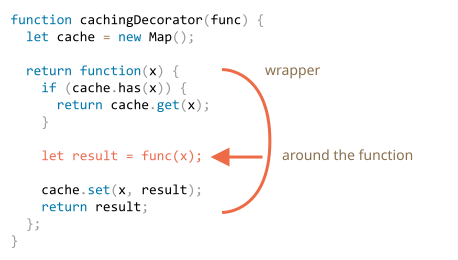

# Decorator และการส่งต่อการเรียก (call forwarding) ด้วย call/apply

ฟังก์ชัน (function) ใน JavaScript ส่งเป็นค่าให้ส่วนอื่นของโปรแกรมได้ และยังใช้งานเป็นออบเจ็กต์ (object) ได้ด้วย บทนี้เราจะใช้ความสามารถเหล่านี้เพื่อ *ส่งต่อการเรียก* จากฟังก์ชันหนึ่งไปยังอีกฟังก์ชันหนึ่ง และใช้ *decorator* เพิ่มพฤติกรรมให้ฟังก์ชัน

## เก็บผลลัพธ์ไว้ใช้ซ้ำโดยไม่เปลี่ยนวิธีเรียก [#transparent-caching]

สมมติว่าเรามีฟังก์ชัน `slow(x)` ที่ต้องประมวลผลหนัก แต่เมื่อรับค่า `x` เดิม ก็จะคืนผลลัพธ์เดิมเสมอ

ถ้าเราเรียกฟังก์ชันนี้บ่อย ๆ การเก็บผลลัพธ์ไว้ใช้ซ้ำ หรือการแคช (cache) จะช่วยให้ไม่ต้องเสียเวลาคำนวณใหม่ทุกครั้ง

เราจะเพิ่มการแคชโดยสร้างฟังก์ชันอีกตัวมารับการเรียกแทน `slow` แล้วค่อยเรียก `slow` เมื่อจำเป็น ฟังก์ชันที่ครอบการทำงานแบบนี้เรียกว่า *wrapper* วิธีนี้ทำให้เพิ่มความสามารถได้โดยไม่ต้องแก้โค้ดภายใน `slow`

ลองดูตัวอย่างก่อน แล้วเราจะไล่การทำงานกัน:

```js run
function slow(x) {
  // อาจมีงานหนักๆ ที่ใช้ CPU สูงอยู่ตรงนี้
  alert(`Called with ${x}`);
  return x;
}

function cachingDecorator(func) {
  let cache = new Map();

  return function(x) {
    if (cache.has(x)) {    // ถ้ามี key นี้ในแคชแล้ว
      return cache.get(x); // ก็อ่านผลลัพธ์จากแคชเลย
    }

    let result = func(x);  // ถ้ายังไม่มี ก็เรียกฟังก์ชันจริง

    cache.set(x, result);  // แล้วเก็บผลลัพธ์ลงแคช
    return result;
  };
}

slow = cachingDecorator(slow);

alert( slow(1) ); // slow(1) ถูกแคชไว้ แล้วคืนค่าผลลัพธ์
alert( "Again: " + slow(1) ); // คืนค่าผลลัพธ์ของ slow(1) จากแคช

alert( slow(2) ); // slow(2) ถูกแคชไว้ แล้วคืนค่าผลลัพธ์
alert( "Again: " + slow(2) ); // คืนค่าผลลัพธ์ของ slow(2) จากแคช
```

เมื่อเรียก `slow(1)` ครั้งแรก wrapper ยังไม่พบค่า `1` ในแคช จึงเรียกฟังก์ชันเดิม แล้วเก็บผลลัพธ์ไว้ใน `Map` เมื่อเรียก `slow(1)` อีกครั้ง ก็คืนค่าจากแคชได้ทันที ส่วน `slow(2)` ทำงานตามขั้นตอนเดียวกัน โดยเก็บผลลัพธ์แยกไว้ด้วยคีย์ (key) `2`

ในตัวอย่างนี้ `cachingDecorator` คือ *decorator*: ฟังก์ชันที่รับฟังก์ชันอื่นเข้ามา แล้วคืนฟังก์ชันที่เพิ่มหรือปรับพฤติกรรมของฟังก์ชันเดิม

เราแยกงานแคชไว้ใน `cachingDecorator` จึงนำไปใช้กับฟังก์ชันอื่นที่ต้องการเก็บผลลัพธ์ไว้ใช้ซ้ำได้ และโค้ดของฟังก์ชันเดิมก็ยังดูแลงานหลักของตัวเองเหมือนเดิม

ค่าที่ `cachingDecorator(func)` คืนมาคือ wrapper `function(x)` ซึ่งตรวจแคชก่อนเรียก `func(x)`:



โค้ดภายนอกยังเรียก `slow(x)` และรับผลลัพธ์ได้เหมือนเดิม ความสามารถที่เพิ่มเข้ามาคือไม่ต้องคำนวณซ้ำเมื่อมีผลลัพธ์ในแคชแล้ว

การแยก `cachingDecorator` ออกมาแทนการแก้ `slow` โดยตรงจึงมีข้อดีดังนี้:

- นำ `cachingDecorator` ไปใช้กับฟังก์ชันอื่นได้
- ขั้นตอนจัดการแคชอยู่แยกจากงานหลักของ `slow` จึงไม่ทำให้โค้ดภายใน `slow` ซับซ้อนขึ้น
- ใช้ decorator หลายตัวร่วมกันได้เมื่อต้องการเพิ่มความสามารถหลายอย่าง เราจะได้เห็น decorator แบบอื่นต่อไป

## ใช้ func.call เพื่อส่งต่อ this [#-func-call--context]

`cachingDecorator` ที่เขียนไว้ยังมีปัญหาเมื่อใช้กับเมธอด (method) ของออบเจ็กต์ที่อาศัย `this`

ตัวอย่างเช่น `worker.slow()` ด้านล่างทำงานได้ตามปกติ แต่เมื่อครอบด้วย decorator แล้วกลับเกิดข้อผิดพลาด:

```js run
// เราจะเพิ่มแคชให้ worker.slow
let worker = {
  someMethod() {
    return 1;
  },

  slow(x) {
    // งานหนักที่ใช้ CPU สูงอยู่ตรงนี้
    alert("Called with " + x);
    return x * this.someMethod(); // (*)
  }
};

// โค้ดเหมือนเดิม
function cachingDecorator(func) {
  let cache = new Map();
  return function(x) {
    if (cache.has(x)) {
      return cache.get(x);
    }
*!*
    let result = func(x); // (**)
*/!*
    cache.set(x, result);
    return result;
  };
}

alert( worker.slow(1) ); // เมธอดเดิมทำงานได้ปกติ

worker.slow = cachingDecorator(worker.slow); // เพิ่มแคชเข้าไป

*!*
alert( worker.slow(2) ); // เกิดข้อผิดพลาด! Cannot read property 'someMethod' of undefined
*/!*
```

ข้อผิดพลาดเกิดที่บรรทัด `(*)` เมื่อฟังก์ชันพยายามอ่าน `this.someMethod`

สาเหตุอยู่ที่บรรทัด `(**)` ภายใน wrapper เราเรียกฟังก์ชันเดิมด้วย `func(x)` โดยไม่ได้เรียกผ่านออบเจ็กต์ เมื่อใช้ strict mode ค่า `this` ในฟังก์ชันจึงเป็น `undefined`

ถ้าแยกเมธอดออกมาเรียกแบบนี้ ก็จะเกิดปัญหาเดียวกัน:

```js
let func = worker.slow;
func(2);
```

wrapper ส่งอาร์กิวเมนต์ (argument) ต่อให้ฟังก์ชันเดิมแล้ว แต่ยังไม่ได้ส่งค่า `this` หรือ context ของการเรียกไปด้วย

เราส่งค่านี้ต่อได้ด้วยเมธอด [func.call(context, ...args)](mdn:js/Function/call) ซึ่งใช้เรียกฟังก์ชันพร้อมกำหนด `this`:

```js
func.call(context, arg1, arg2, ...)
```

อาร์กิวเมนต์ตัวแรกของ `call` คือค่าที่จะใช้เป็น `this` ส่วนอาร์กิวเมนต์ที่เหลือจะส่งให้ `func`

ลองเปรียบเทียบการเรียกสองแบบนี้:

```js
func(1, 2, 3);
func.call(obj, 1, 2, 3)
```

ทั้งสองแบบเรียก `func` ด้วยอาร์กิวเมนต์ `1`, `2` และ `3` เหมือนกัน แต่ `func.call` กำหนดให้ `this` เป็น `obj` ด้วย

ตัวอย่างถัดไปใช้ `sayHi` ฟังก์ชันเดียวกันกับออบเจ็กต์สองตัว การเรียก `sayHi.call(user)` ทำให้ `this` เป็น `user` จึงแสดง `John` ส่วน `sayHi.call(admin)` ทำให้ `this` เป็น `admin` จึงแสดง `Admin`:

```js run
function sayHi() {
  alert(this.name);
}

let user = { name: "John" };
let admin = { name: "Admin" };

// ใช้ call เพื่อส่งออบเจ็กต์ต่างๆ เข้าไปเป็น "this"
sayHi.call( user ); // John
sayHi.call( admin ); // Admin
```

ถ้าฟังก์ชันต้องรับอาร์กิวเมนต์ด้วย ก็ส่งค่าต่อจาก context ได้ ในตัวอย่างนี้ `user` เป็น `this` และ `"Hello"` เป็นค่าของ `phrase`:

```js run
function say(phrase) {
  alert(this.name + ': ' + phrase);
}

let user = { name: "John" };

// user กลายเป็น this และ "Hello" เป็นอาร์กิวเมนต์ตัวแรก
say.call( user, "Hello" ); // John: Hello
```

เมื่อนำมาใช้ใน wrapper เราก็เปลี่ยนจาก `func(x)` เป็น `func.call(this, x)` เพื่อส่ง `this` ที่ wrapper ได้รับต่อไปยังฟังก์ชันเดิม:

```js run
let worker = {
  someMethod() {
    return 1;
  },

  slow(x) {
    alert("Called with " + x);
    return x * this.someMethod(); // (*)
  }
};

function cachingDecorator(func) {
  let cache = new Map();
  return function(x) {
    if (cache.has(x)) {
      return cache.get(x);
    }
*!*
    let result = func.call(this, x); // ตอนนี้ "this" ถูกส่งต่อไปอย่างถูกต้องแล้ว
*/!*
    cache.set(x, result);
    return result;
  };
}

worker.slow = cachingDecorator(worker.slow); // เพิ่มแคชเข้าไป

alert( worker.slow(2) ); // ทำงานได้แล้ว
alert( worker.slow(2) ); // ทำงานได้ ไม่ได้เรียกฟังก์ชันเดิม (ใช้จากแคช)
```

ตอนนี้ `worker.slow(2)` ทำงานได้ และเมื่อเรียกซ้ำก็คืนค่าจากแคช

ลำดับการส่งต่อ `this` เป็นดังนี้:

1. เมื่อครอบด้วย decorator แล้ว `worker.slow` จะอ้างถึง wrapper `function(x) { ... }`
2. การเรียก `worker.slow(2)` ส่งอาร์กิวเมนต์ `2` ให้ wrapper และทำให้ `this` เป็น `worker` ซึ่งเป็นออบเจ็กต์ที่อยู่ก่อนจุด
3. ถ้ายังไม่มีผลลัพธ์ในแคช wrapper จะเรียก `func.call(this, x)` โดยส่ง `worker` เป็น `this` และส่ง `2` เป็นอาร์กิวเมนต์ให้เมธอดเดิม

## รองรับหลายอาร์กิวเมนต์ [#going-multi-argument]

ตอนนี้ `cachingDecorator` รองรับฟังก์ชันที่รับอาร์กิวเมนต์ตัวเดียว ต่อไปเราจะปรับให้ใช้กับเมธอดที่รับหลายค่า เช่น `worker.slow(min, max)`:

```js
let worker = {
  slow(min, max) {
    return min + max; // สมมติว่าเป็นงานหนัก
  }
};

// ต้องจำผลลัพธ์สำหรับอาร์กิวเมนต์ชุดเดียวกัน
worker.slow = cachingDecorator(worker.slow);
```

เมื่อมีอาร์กิวเมนต์เพียง `x` เราใช้ `cache.set(x, result)` เก็บผลลัพธ์ และใช้ `cache.get(x)` อ่านค่ากลับมาได้เลย แต่สำหรับ `(min, max)` ผลลัพธ์ขึ้นอยู่กับอาร์กิวเมนต์ *ทั้งคู่* ขณะที่ `Map` ใช้ค่าเพียงค่าเดียวเป็นคีย์

เราจัดการได้หลายวิธี:

1. สร้างโครงสร้างข้อมูลที่ทำงานคล้าย `Map` แต่รองรับหลายคีย์ หรือใช้โครงสร้างสำเร็จรูปจากไลบรารี (library) ภายนอก
2. ใช้ `Map` ซ้อนกัน โดยค่าที่อ่านได้จาก `cache.get(min)` เป็น `Map` อีกตัวที่เก็บคู่ `(max, result)` จากนั้นอ่านผลลัพธ์ด้วย `cache.get(min).get(max)`
3. รวมอาร์กิวเมนต์เป็นค่าเดียว ในตัวอย่างนี้ใช้สตริง (string) รูปแบบ `"min,max"` เป็นคีย์ได้ และเพื่อให้ปรับใช้กับกรณีอื่นได้ เราจะให้ decorator รับ *hashing function* ซึ่งทำหน้าที่สร้างคีย์หนึ่งค่าจากอาร์กิวเมนต์หลายค่า

วิธีที่สามใช้ได้กับงานหลายกรณี เราจะใช้วิธีนี้ในตัวอย่าง

อีกจุดที่ต้องปรับคือการส่งอาร์กิวเมนต์ให้ฟังก์ชันเดิม ภายในฟังก์ชันที่ประกาศด้วย `function` เราเข้าถึงอาร์กิวเมนต์ทั้งหมดได้ผ่าน `arguments` ซึ่งเป็นออบเจ็กต์ที่มีลักษณะคล้ายอาร์เรย์ (array) หรือที่เรียกว่า array-like ในตัวอย่างนี้เราใช้ spread syntax `...arguments` ส่งค่าทั้งหมดต่อไป จึงเปลี่ยนจาก `func.call(this, x)` เป็น `func.call(this, ...arguments)`

`cachingDecorator` ที่ปรับแล้วเป็นดังนี้:

```js run
let worker = {
  slow(min, max) {
    alert(`Called with ${min},${max}`);
    return min + max;
  }
};

function cachingDecorator(func, hash) {
  let cache = new Map();
  return function() {
*!*
    let key = hash(arguments); // (*)
*/!*
    if (cache.has(key)) {
      return cache.get(key);
    }

*!*
    let result = func.call(this, ...arguments); // (**)
*/!*

    cache.set(key, result);
    return result;
  };
}

function hash(args) {
  return args[0] + ',' + args[1];
}

worker.slow = cachingDecorator(worker.slow, hash);

alert( worker.slow(3, 5) ); // ทำงานได้
alert( "Again " + worker.slow(3, 5) ); // เหมือนเดิม (จากแคช)
```

wrapper นี้ส่งต่ออาร์กิวเมนต์ได้หลายตัวแล้ว แต่ `hash` ในตัวอย่างยังรวมค่าเพียงสองตัว ถ้าต้องการรองรับจำนวนอาร์กิวเมนต์เท่าไรก็ได้ ต้องปรับ `hash` ด้วย เราจะทำส่วนนี้ในหัวข้อการยืมเมธอด

มีการเปลี่ยนแปลงสองจุดที่ควรสังเกต:

- บรรทัด `(*)` เรียก `hash(arguments)` เพื่อสร้างคีย์จากอาร์กิวเมนต์ทั้งหมด ในตัวอย่างนี้ `hash` เชื่อมค่า `(3, 5)` ให้เป็นสตริง `"3,5"` กรณีที่ซับซ้อนกว่านี้อาจต้องใช้วิธีสร้างคีย์แบบอื่น
- บรรทัด `(**)` ใช้ `func.call(this, ...arguments)` ส่งทั้ง `this` และอาร์กิวเมนต์ทุกตัวที่ wrapper ได้รับไปยังฟังก์ชันเดิม

## func.apply

นอกจาก `func.call(this, ...arguments)` แล้ว เรายังเขียนเป็น `func.apply(this, arguments)` ได้ด้วย

เมธอด [func.apply](mdn:js/Function/apply) มีรูปแบบการเรียกดังนี้:

```js
func.apply(context, args)
```

การเรียกนี้ให้ `func` ทำงานโดยใช้ `context` เป็น `this` และนำค่าจากออบเจ็กต์แบบ array-like ชื่อ `args` ไปเป็นอาร์กิวเมนต์

ความต่างของรูปแบบการเรียกคือ `call` รับอาร์กิวเมนต์ทีละตัว ส่วน `apply` รับออบเจ็กต์แบบ array-like ที่รวมอาร์กิวเมนต์เหล่านั้นไว้

ตัวอย่างสองบรรทัดนี้จึงส่ง context และอาร์กิวเมนต์ชุดเดียวกันให้ `func`:

```js
func.call(context, ...args);
func.apply(context, args);
```

แต่สิ่งที่ `args` ต้องรองรับต่างกันเล็กน้อย:

- spread syntax `...` ที่ใช้กับ `call` ต้องการ `args` ที่เป็น *iterable* หรือค่าที่นำสมาชิกออกมาทีละตัวได้
- `apply` ต้องการ `args` ที่เป็น *array-like* คือมีสมาชิกตามตำแหน่งและมี `length` บอกจำนวนสมาชิก

ถ้า `args` เป็นทั้ง iterable และ array-like เช่น อาร์เรย์ ก็เลือกใช้ได้ทั้งสองแบบ

การส่งทั้งอาร์กิวเมนต์และ context ไปยังอีกฟังก์ชันหนึ่งคือ *การส่งต่อการเรียก* ที่กล่าวถึงตอนต้นบท รูปแบบพื้นฐานเขียนได้ดังนี้:

```js
let wrapper = function() {
  return func.apply(this, arguments);
};
```

เมื่อเรียก wrapper นี้ `func` จะได้รับ `this` และอาร์กิวเมนต์ชุดเดียวกัน และ wrapper จะคืนค่าที่ `func` คืนมาให้ผู้เรียกด้วย

## การยืมเมธอด (method borrowing) [#method-borrowing]

ทีนี้กลับมาปรับ hashing function ซึ่งตอนนี้ยังรวมค่าเพียงสองตัว:

```js
function hash(args) {
  return args[0] + ',' + args[1];
}
```

เราต้องการให้รวมอาร์กิวเมนต์ได้ไม่ว่าจะมีกี่ตัว เมธอด [arr.join](mdn:js/Array/join) น่าจะช่วยได้ จึงอาจลองเขียนแบบนี้:

```js
function hash(args) {
  return args.join();
}
```

แต่เราเรียก `hash(arguments)` ซึ่งส่งออบเจ็กต์ `arguments` เข้าไป แม้ `arguments` จะเป็นทั้ง iterable และ array-like แต่ก็ไม่ใช่อาร์เรย์และไม่มีเมธอด `join`

จึงเกิดข้อผิดพลาดเมื่อเรียก `join` โดยตรง:

```js run
function hash() {
*!*
  alert( arguments.join() ); // Error: arguments.join is not a function
*/!*
}

hash(1, 2);
```

เรายังใช้ `join` ของอาร์เรย์กับ `arguments` ได้ โดยเรียกผ่าน `call`:

```js run
function hash() {
*!*
  alert( [].join.call(arguments) ); // 1,2
*/!*
}

hash(1, 2);
```

เทคนิคนี้คือ *การยืมเมธอด* เราอ่านเมธอด `join` จากอาร์เรย์ว่างด้วย `[].join` แล้วใช้ `call(arguments)` เรียกเมธอดนั้นโดยให้ `this` เป็น `arguments`

วิธีนี้ใช้ได้เพราะ `join` ไม่ได้บังคับให้ `this` เป็นอาร์เรย์จริง ขั้นตอนหลักของ `arr.join(glue)` คืออ่านสมาชิกตามตำแหน่งแล้วเชื่อมเป็นสตริง ดังนี้:

1. ใช้อาร์กิวเมนต์ตัวแรกเป็นตัวคั่น `glue` ถ้าไม่ได้ส่งค่ามาให้ใช้จุลภาค `","`
2. เริ่มจาก `result` ที่เป็นสตริงว่าง
3. ต่อ `this[0]` เข้าไปใน `result`
4. ต่อ `glue` แล้วตามด้วย `this[1]`
5. ต่อ `glue` แล้วตามด้วย `this[2]`
6. ทำเช่นนี้ต่อไปจนครบจำนวนสมาชิกตาม `this.length`
7. คืนค่า `result`

`join` จึงต้องการเพียง `this` ที่มีสมาชิกอย่าง `this[0]`, `this[1]` และมี `length` ไม่จำเป็นต้องเป็นอาร์เรย์ นี่เป็นพฤติกรรมที่ออกแบบไว้ให้ใช้กับออบเจ็กต์แบบ array-like ได้ และเมธอดอีกหลายตัวก็ทำงานในลักษณะเดียวกัน การกำหนด `this` เป็น `arguments` จึงใช้ได้

## Decorator กับพร็อพเพอร์ตี้ (property) ของฟังก์ชัน [#decorator-]

โดยทั่วไปเราสามารถใช้ฟังก์ชันที่ครอบด้วย decorator แทนฟังก์ชันหรือเมธอดเดิมได้ แต่ต้องระวังหากมีโค้ดใช้งานพร็อพเพอร์ตี้ของฟังก์ชัน เช่น `func.calledCount` เพราะ wrapper เป็นคนละฟังก์ชันและไม่ได้มีพร็อพเพอร์ตี้เหล่านั้นติดมาด้วย

เช่น ถ้า `slow` มีพร็อพเพอร์ตี้อยู่ `cachingDecorator(slow)` ก็จะคืน wrapper ที่ไม่มีพร็อพเพอร์ตี้เหล่านั้น

ในทางกลับกัน decorator บางตัวอาจเพิ่มพร็อพเพอร์ตี้ให้ wrapper ของตัวเอง เช่น เก็บจำนวนครั้งที่เรียกฟังก์ชันหรือเวลาที่ใช้ทำงาน แล้วให้โค้ดภายนอกอ่านข้อมูลเหล่านี้ผ่านพร็อพเพอร์ตี้ของ wrapper

ถ้าต้องการครอบฟังก์ชันแล้วยังเข้าถึงพร็อพเพอร์ตี้เดิมได้ ก็มีวิธีใช้ `Proxy` ช่วย ซึ่งเราจะเรียนในบท <info:proxy#proxy-apply>

## สรุป [#-2]

*Decorator* เพิ่มหรือปรับพฤติกรรมของฟังก์ชันผ่าน wrapper โดยยังให้ฟังก์ชันเดิมทำงานหลักเหมือนเดิม เราจะเพิ่มความสามารถเพียงอย่างเดียวหรือใช้ decorator หลายตัวร่วมกันก็ได้ โดยไม่ต้องแก้โค้ดภายในฟังก์ชันเดิม

ระหว่างสร้าง `cachingDecorator` เราได้ใช้เมธอดสองตัวนี้:

- [func.call(context, arg1, arg2...)](mdn:js/Function/call) เรียก `func` โดยให้ `this` เป็น `context` และส่งอาร์กิวเมนต์ทีละตัว
- [func.apply(context, args)](mdn:js/Function/apply) เรียก `func` โดยให้ `this` เป็น `context` และส่งอาร์กิวเมนต์จากออบเจ็กต์แบบ array-like ชื่อ `args`

รูปแบบทั่วไปของการส่งต่อการเรียกด้วย `apply` คือ:

```js
let wrapper = function() {
  return original.apply(this, arguments);
};
```

เรายังได้ใช้การยืมเมธอด โดยนำเมธอดของออบเจ็กต์หนึ่งมาเรียกผ่าน `call` แล้วกำหนด `this` เป็นอีกออบเจ็กต์หนึ่ง ตัวอย่างที่พบบ่อยคือยืมเมธอดของอาร์เรย์มาใช้กับ `arguments` อีกทางเลือกหนึ่งคือใช้ rest parameters เพื่อรับอาร์กิวเมนต์เป็นอาร์เรย์โดยตรง

Decorator ยังใช้เพิ่มพฤติกรรมได้อีกหลายแบบ ลองฝึกเขียนด้วยโจทย์ท้ายบทนี้
