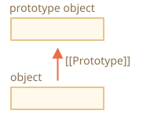
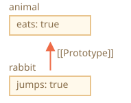
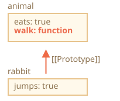
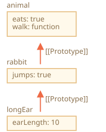
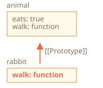
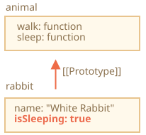
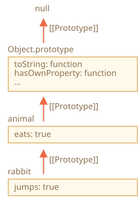

# การสืบทอดผ่านโปรโตไทป์ (prototypal inheritance)

เวลาเขียนโปรแกรม เรามักอยากนำสิ่งที่มีอยู่แล้วมาต่อยอด

สมมติว่าเรามีออบเจ็กต์ (object) ชื่อ `user` ซึ่งมีพร็อพเพอร์ตี้ (property) และเมธอด (method) ที่ทั้ง `admin` และ `guest` ต้องใช้ เราอยากสร้างออบเจ็กต์สองตัวนี้ให้ต่างจาก `user` เพียงบางจุด โดยใช้เมธอดเดิมได้เลย ไม่ต้องคัดลอกหรือเขียนขึ้นใหม่

JavaScript มีกลไกที่ช่วยให้ทำแบบนี้ได้ เรียกว่า *การสืบทอดผ่านโปรโตไทป์*

## [[Prototype]]

ในข้อกำหนดของ JavaScript ออบเจ็กต์ทั่วไปมีช่องภายในชื่อ `[[Prototype]]` ค่าของช่องนี้เป็น `null` หรืออ้างถึงออบเจ็กต์อีกตัวหนึ่ง เราเรียกออบเจ็กต์ที่ช่องนี้อ้างถึงว่า *โปรโตไทป์* (prototype)



เมื่อเราอ่านพร็อพเพอร์ตี้ที่ตัวออบเจ็กต์เองไม่มี JavaScript จะค้นหาในโปรโตไทป์ต่อให้โดยอัตโนมัติ นี่คือการสืบทอดผ่านโปรโตไทป์ ต่อไปเราจะได้เห็นทั้งตัวอย่างการสืบทอดและความสามารถอื่นของภาษาที่อาศัยกลไกนี้

แม้ `[[Prototype]]` จะเป็นช่องภายใน แต่เรากำหนดค่าให้ช่องนี้ได้หลายวิธี

วิธีหนึ่งคือใช้ชื่อพิเศษ `__proto__` ดังตัวอย่างนี้

```js run
let animal = {
  eats: true
};
let rabbit = {
  jumps: true
};

*!*
rabbit.__proto__ = animal; // กำหนดให้ rabbit.[[Prototype]] = animal
*/!*
```

เมื่ออ่านพร็อพเพอร์ตี้ที่ `rabbit` เองไม่มี JavaScript ก็จะค้นหาใน `animal` ต่อ

ลองเปรียบเทียบการอ่าน `rabbit.eats` กับ `rabbit.jumps`

```js
let animal = {
  eats: true
};
let rabbit = {
  jumps: true
};

*!*
rabbit.__proto__ = animal; // (*)
*/!*

// ตอนนี้เราหาพร็อพเพอร์ตี้ทั้งสองตัวได้จาก rabbit:
*!*
alert( rabbit.eats ); // true (**)
*/!*
alert( rabbit.jumps ); // true
```

บรรทัด `(*)` กำหนดให้ `animal` เป็นโปรโตไทป์ของ `rabbit`

เมื่ออ่าน `rabbit.eats` ในบรรทัด `(**)` JavaScript หา `eats` ใน `rabbit` ไม่พบ จึงตาม `[[Prototype]]` ขึ้นไปจนพบ `eats` ใน `animal` ส่วน `jumps` นั้นพบใน `rabbit` เอง ทั้งสองบรรทัดจึงแสดง `true`



เราจึงอธิบายความสัมพันธ์เดียวกันนี้ได้สองแบบ คือ “`animal` เป็นโปรโตไทป์ของ `rabbit`” หรือ “`rabbit` สืบทอดจาก `animal`”

ถ้า `animal` มีพร็อพเพอร์ตี้และเมธอดอื่น ๆ เราก็เข้าถึงสิ่งเหล่านั้นผ่าน `rabbit` ได้เช่นกัน เราเรียกพร็อพเพอร์ตี้ที่ได้มาทางโปรโตไทป์ว่า *พร็อพเพอร์ตี้ที่สืบทอดมา* (inherited property)

ตัวอย่างเช่น ถ้า `animal` มีเมธอด `walk` เราก็เรียก `rabbit.walk()` ได้

```js run
let animal = {
  eats: true,
*!*
  walk() {
    alert("Animal walk");
  }
*/!*
};

let rabbit = {
  jumps: true,
  __proto__: animal
};

// walk ถูกดึงมาจากโปรโตไทป์
*!*
rabbit.walk(); // Animal walk
*/!*
```

เมื่อเรียก `rabbit.walk()` JavaScript พบเมธอด `walk` ใน `animal` แล้วเรียกเมธอดนั้น จึงแสดงข้อความ `Animal walk`



โปรโตไทป์ก็มีโปรโตไทป์ของตัวเองได้ เราเรียกลำดับที่เชื่อมต่อกันนี้ว่า *ห่วงโซ่โปรโตไทป์* (prototype chain)

```js run
let animal = {
  eats: true,
  walk() {
    alert("Animal walk");
  }
};

let rabbit = {
  jumps: true,
*!*
  __proto__: animal
*/!*
};

let longEar = {
  earLength: 10,
*!*
  __proto__: rabbit
*/!*
};

// walk ถูกดึงมาจากห่วงโซ่โปรโตไทป์
longEar.walk(); // Animal walk
alert(longEar.jumps); // true (มาจาก rabbit)
```



ถ้าไม่พบพร็อพเพอร์ตี้ใน `longEar` JavaScript จะหาใน `rabbit` ก่อน ถ้ายังไม่พบจึงหาใน `animal` ต่อ ในตัวอย่างนี้จึงพบ `jumps` ที่ `rabbit` และพบ `walk` ที่ `animal`

การกำหนดโปรโตไทป์แบบนี้มีข้อจำกัดสองข้อ

1. ห่วงโซ่ต้องไม่วนกลับมาหาตัวเอง ถ้าเรากำหนด `__proto__` จนเกิดวง JavaScript จะแจ้งข้อผิดพลาด
2. ค่าที่กำหนดให้ `__proto__` ต้องเป็นออบเจ็กต์หรือ `null` ถ้าให้ค่าชนิดอื่น โปรโตไทป์เดิมจะยังคงอยู่

ออบเจ็กต์แต่ละตัวมีช่อง `[[Prototype]]` เพียงช่องเดียว จึงมีโปรโตไทป์โดยตรงพร้อมกันสองตัวไม่ได้

```smart header="`__proto__` เป็น getter/setter แบบเดิมที่ใช้เข้าถึง `[[Prototype]]`"
สองชื่อนี้เกี่ยวข้องกัน แต่ทำหน้าที่ต่างกัน

`[[Prototype]]` คือช่องภายใน ส่วน `__proto__` มีฟังก์ชัน (function) สำหรับอ่านค่า (getter) และกำหนดค่า (setter) ของช่องนั้น เราจะได้เห็นความสำคัญของความแตกต่างนี้ในบทต่อไป

JavaScript ยังคงพร็อพเพอร์ตี้ `__proto__` ไว้เพื่อให้โค้ดเก่าทำงานได้ สำหรับโค้ดใหม่ เราใช้ `Object.getPrototypeOf` เพื่ออ่านโปรโตไทป์ และใช้ `Object.setPrototypeOf` เพื่อเปลี่ยนโปรโตไทป์ได้ เราจะเรียนทั้งสองวิธีในภายหลัง

มาตรฐาน ECMAScript 2026 กำหนดให้เว็บเบราว์เซอร์ (web browser) รองรับพร็อพเพอร์ตี้ `__proto__` เพื่อให้เว็บเดิมทำงานได้ ส่วนสภาพแวดล้อมอื่นเลือกได้ว่าจะรองรับหรือไม่ เช่น Node.js เปิดให้ใช้ตามค่าเริ่มต้น

ในตัวอย่างของบทนี้เราจะใช้ `__proto__` เพราะมองเห็นได้ทันทีว่าออบเจ็กต์ไหนเป็นโปรโตไทป์ของออบเจ็กต์ไหน
```

## การเขียนค่าลงในตัวออบเจ็กต์ [#writing-doesnt-use-prototype]

ตอน*อ่าน*พร็อพเพอร์ตี้ JavaScript อาจพบค่าในโปรโตไทป์

แต่ถ้าเรากำหนดค่าหรือลบพร็อพเพอร์ตี้อย่างในตัวอย่างต่อไปนี้ การเปลี่ยนแปลงจะเกิดกับตัวออบเจ็กต์เอง

ลองกำหนดเมธอด `walk` ให้ `rabbit` มีเป็นของตัวเอง

```js run
let animal = {
  eats: true,
  walk() {
    /* rabbit จะไม่ใช้เมธอดนี้ */
  }
};

let rabbit = {
  __proto__: animal
};

*!*
rabbit.walk = function() {
  alert("Rabbit! Bounce-bounce!");
};
*/!*

rabbit.walk(); // Rabbit! Bounce-bounce!
```

ตอนนี้เมื่อเรียก `rabbit.walk()` JavaScript จะพบ `walk` ในตัว `rabbit` เองและเรียกเมธอดนั้นทันที จึงแสดง `Rabbit! Bounce-bounce!`



กรณีหนึ่งที่ต่างออกไปคือพร็อพเพอร์ตี้ที่ใช้ getter หรือ setter (accessor property) ถ้าพร็อพเพอร์ตี้ที่สืบทอดมามี setter การกำหนดค่าจะเรียกฟังก์ชัน setter นั้น

ลองดูว่าเกิดอะไรขึ้นเมื่อเราอ่านและเขียน `admin.fullName`

```js run
let user = {
  name: "John",
  surname: "Smith",

  set fullName(value) {
    [this.name, this.surname] = value.split(" ");
  },

  get fullName() {
    return `${this.name} ${this.surname}`;
  }
};

let admin = {
  __proto__: user,
  isAdmin: true
};

alert(admin.fullName); // John Smith (*)

// setter ทำงาน!
admin.fullName = "Alice Cooper"; // (**)

alert(admin.fullName); // Alice Cooper, สถานะของ admin เปลี่ยน
alert(user.fullName); // John Smith, สถานะของ user ไม่ถูกแตะต้อง
```

บรรทัด `(*)` อ่าน `admin.fullName` จึงเรียก getter ที่อยู่ใน `user` และได้ชื่อ `John Smith` ส่วนบรรทัด `(**)` กำหนดค่าให้ `admin.fullName` จึงเรียก setter ที่อยู่ใน `user` เช่นกัน

## ค่าของ this

เมื่อ setter `set fullName(value)` ทำงาน ค่า `this` คืออะไร? บรรทัดที่กำหนดค่าให้ `this.name` กับ `this.surname` เขียนชื่อลงใน `user` หรือ `admin`?

ตำแหน่งที่ JavaScript พบเมธอดไม่มีผลต่อค่าของ `this`

**สำหรับเมธอดที่เขียนแบบในตัวอย่าง เมื่อเรียก `obj.method()` ค่า `this` คือ `obj` ไม่ว่า JavaScript จะพบเมธอดบน `obj` เองหรือบนโปรโตไทป์**

เมื่อกำหนด `admin.fullName = "Alice Cooper"` ค่า `this` ใน setter จึงเป็น `admin` ชื่อและนามสกุลใหม่ไปอยู่บน `admin` ส่วนชื่อบน `user` ยังเป็น `John Smith`

ด้วยหลักเดียวกันนี้ เราจึงเก็บเมธอดไว้ในออบเจ็กต์เดียวแล้วให้ออบเจ็กต์หลายตัวสืบทอดไปใช้ได้ เมื่อเมธอดกำหนดค่าให้พร็อพเพอร์ตี้บน `this` โดยตรงเหมือนในตัวอย่าง ค่าที่เปลี่ยนจะเป็นของออบเจ็กต์ที่เรียกเมธอด

ตัวอย่างต่อไปนี้เก็บเมธอด `walk` และ `sleep` ไว้ใน `animal` แล้วให้ `rabbit` สืบทอดไปใช้

เมื่อเรียก `rabbit.sleep()` บรรทัด `this.isSleeping = true` จึงกำหนดค่าให้ `rabbit.isSleeping`

```js run
// animal มีเมธอดต่างๆ
let animal = {
  walk() {
    if (!this.isSleeping) {
      alert(`I walk`);
    }
  },
  sleep() {
    this.isSleeping = true;
  }
};

let rabbit = {
  name: "White Rabbit",
  __proto__: animal
};

// แก้ไขค่า rabbit.isSleeping
rabbit.sleep();

alert(rabbit.isSleeping); // true
alert(animal.isSleeping); // undefined (ไม่มีพร็อพเพอร์ตี้นี้ในโปรโตไทป์)
```

หลังจากเรียก `sleep` แล้ว `rabbit` มีพร็อพเพอร์ตี้ `isSleeping` เป็นของตัวเอง ส่วน `animal.isSleeping` ยังให้ค่า `undefined`



ถ้า `bird` และ `snake` สืบทอดจาก `animal` ด้วย ทั้งคู่ก็ใช้เมธอดเดียวกันนี้ได้ เมื่อเรียก `bird.sleep()` ค่า `this` คือ `bird` และเมื่อเรียก `snake.sleep()` ค่า `this` คือ `snake` แต่ละตัวจึงเก็บค่า `isSleeping` ของตัวเอง

ออบเจ็กต์เหล่านี้จึงใช้เมธอดร่วมกันได้ ขณะที่แต่ละตัวยังมีสถานะของตัวเอง

## การวนลูป (loop) ด้วย for..in [#-for-in]

เมื่อใช้ `for..in` วนดูชื่อพร็อพเพอร์ตี้ เราจะพบพร็อพเพอร์ตี้ที่สืบทอดมาด้วย

ลองเปรียบเทียบผลของ `Object.keys(rabbit)` กับ `for..in`

```js run
let animal = {
  eats: true
};

let rabbit = {
  jumps: true,
  __proto__: animal
};

*!*
// Object.keys คืนเฉพาะ key ของตัวเอง
alert(Object.keys(rabbit)); // jumps
*/!*

*!*
// for..in วนทั้ง key ของตัวเองและ key ที่สืบทอดมา
for(let prop in rabbit) alert(prop); // jumps, แล้วก็ eats
*/!*
```

ถ้าอยากรู้ว่าพร็อพเพอร์ตี้เป็นของออบเจ็กต์เองหรือสืบทอดมา ให้ใช้เมธอด [`obj.hasOwnProperty(key)`](https://developer.mozilla.org/en-US/docs/Web/JavaScript/Reference/Global_Objects/Object/hasOwnProperty) ซึ่งคืนค่า `true` เมื่อ `obj` มีพร็อพเพอร์ตี้ชื่อ `key` เป็นของตัวเอง

เราจึงเลือกข้ามพร็อพเพอร์ตี้ที่สืบทอดมาหรือจัดการแยกต่างหากได้ ตัวอย่างนี้แสดง `Our: jumps` สำหรับพร็อพเพอร์ตี้ของ `rabbit` เอง และ `Inherited: eats` สำหรับพร็อพเพอร์ตี้ที่สืบทอดมา

```js run
let animal = {
  eats: true
};

let rabbit = {
  jumps: true,
  __proto__: animal
};

for(let prop in rabbit) {
  let isOwn = rabbit.hasOwnProperty(prop);

  if (isOwn) {
    alert(`Our: ${prop}`); // Our: jumps
  } else {
    alert(`Inherited: ${prop}`); // Inherited: eats
  }
}
```

ในตัวอย่างนี้ `rabbit` สืบทอดจาก `animal` และเนื่องจากเราสร้าง `animal` ด้วย `{...}` โดยไม่ได้ระบุโปรโตไทป์ จึงมี `Object.prototype` เป็นโปรโตไทป์ตามค่าเริ่มต้น ห่วงโซ่ไปสิ้นสุดที่ `null`



แล้ว `rabbit.hasOwnProperty` มาจากไหน ในเมื่อเราไม่ได้เขียนเมธอดนี้ไว้ใน `rabbit` หรือ `animal`? ลองไล่ตามห่วงโซ่ จะพบว่า `rabbit` สืบทอดเมธอดนี้มาจาก `Object.prototype`

ในเมื่อ `for..in` วนดูพร็อพเพอร์ตี้ที่สืบทอดมาด้วย ทำไมเราจึงเห็น `eats` กับ `jumps` แต่ไม่เห็น `hasOwnProperty`?

ลูป `for..in` วนดูเฉพาะพร็อพเพอร์ตี้ที่มีชื่อเป็นสตริง (string) และเปิดให้ไล่ชื่อได้ (enumerable) ส่วน `hasOwnProperty` และพร็อพเพอร์ตี้อื่น ๆ ที่มีมาให้ใน `Object.prototype` มีค่า `enumerable` เป็น `false` ลูปจึงข้ามไป

```smart header="เมธอดส่วนใหญ่ที่ใช้ดูชื่อหรือค่าของพร็อพเพอร์ตี้จะข้ามพร็อพเพอร์ตี้ที่สืบทอดมา"
เมธอดอย่าง `Object.keys` และ `Object.values` ใช้ดูชื่อและค่าของพร็อพเพอร์ตี้ตามลำดับ

ทั้งสองเมธอดดูเฉพาะพร็อพเพอร์ตี้ของตัวออบเจ็กต์เองที่มีชื่อเป็นสตริงและเปิดให้ไล่ชื่อได้ จึง*ไม่รวมพร็อพเพอร์ตี้จากโปรโตไทป์*
```

## สรุป [#-2]

- ออบเจ็กต์ทั่วไปใน JavaScript มีช่องภายในชื่อ `[[Prototype]]` ซึ่งอ้างถึงออบเจ็กต์อีกตัวหนึ่งหรือมีค่าเป็น `null`
- `obj.__proto__` เป็นวิธีเดิมที่ใช้ getter และ setter เพื่ออ่านหรือเปลี่ยนโปรโตไทป์ เรายังมีวิธีอื่นที่จะได้เรียนต่อไป
- เราเรียกออบเจ็กต์ที่ `[[Prototype]]` อ้างถึงว่าโปรโตไทป์
- เมื่ออ่านพร็อพเพอร์ตี้หรือเรียกเมธอดที่ `obj` เองไม่มี JavaScript จะค้นหาในโปรโตไทป์ต่อ
- ถ้าเขียนพร็อพเพอร์ตี้ที่เก็บข้อมูลได้สำเร็จ ค่าใหม่จะอยู่บนตัวออบเจ็กต์เอง แต่ถ้าชื่อนั้นมี setter ที่สืบทอดมา การกำหนดค่าจะเรียก setter ส่วน `delete` ลบได้เฉพาะพร็อพเพอร์ตี้ของตัวออบเจ็กต์เอง
- เมธอดในตัวอย่างใช้ `this` ตามออบเจ็กต์ที่เรียก เมื่อเขียน `rabbit.sleep()` ค่า `this` จึงเป็น `rabbit` แม้ `sleep` จะอยู่บน `animal`
- สำหรับพร็อพเพอร์ตี้ที่มีชื่อเป็นสตริงและไล่ชื่อได้ `for..in` จะเห็นทั้งชื่อบนตัวออบเจ็กต์เองและชื่อที่สืบทอดมา ส่วน `Object.keys` และ `Object.values` ดูเฉพาะของตัวออบเจ็กต์เอง
