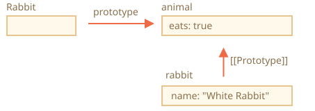
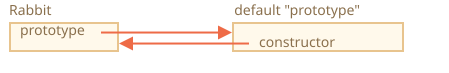
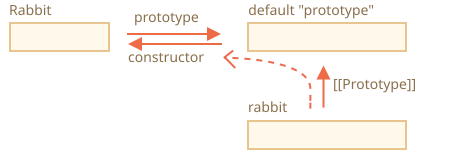

# F.prototype

เมื่อเราเขียน `new F()` เราเรียกฟังก์ชัน (function) ชื่อ `F` เป็นคอนสตรักเตอร์ (constructor) เพื่อสร้างออบเจ็กต์ (object) ใหม่

ถ้า `F.prototype` เป็นออบเจ็กต์ ตัวดำเนินการ (operator) `new` จะใช้ออบเจ็กต์นั้นเป็นโปรโตไทป์ (prototype) ของออบเจ็กต์ที่เพิ่งสร้าง นั่นคือค่าของ `[[Prototype]]`

```smart
การสืบทอดผ่านโปรโตไทป์ (prototypal inheritance) เป็นหนึ่งในกลไกหลักของ JavaScript มาตั้งแต่เริ่มต้น

ในช่วงแรก JavaScript ยังไม่มีวิธีเข้าถึง `[[Prototype]]` โดยตรง วิธีที่ใช้ได้เหมือนกันในสภาพแวดล้อมต่าง ๆ คือกำหนดโปรโตไทป์ผ่านพร็อพเพอร์ตี้ (property) ชื่อ `"prototype"` ของคอนสตรักเตอร์ เราจึงยังพบโค้ดที่ใช้วิธีนี้อยู่บ่อย ๆ
```

ชื่อสองชื่อนี้คล้ายกัน แต่เป็นคนละส่วนกัน `F.prototype` คือพร็อพเพอร์ตี้ธรรมดาชื่อ `"prototype"` ของฟังก์ชัน `F` ส่วน `[[Prototype]]` คือช่องภายในของออบเจ็กต์ที่เก็บว่าออบเจ็กต์นั้นสืบทอดจากไหน

ลองดูว่าเกิดอะไรขึ้นเมื่อเรากำหนด `Rabbit.prototype` แล้วสร้าง `rabbit`

```js run
let animal = {
  eats: true
};

function Rabbit(name) {
  this.name = name;
}

*!*
Rabbit.prototype = animal;
*/!*

let rabbit = new Rabbit("White Rabbit"); //  rabbit.__proto__ == animal

alert( rabbit.eats ); // true
```

เมื่อเขียน `Rabbit.prototype = animal` แล้วเรียก `new Rabbit("White Rabbit")` ออบเจ็กต์ `rabbit` ที่ได้จะมี `animal` เป็น `[[Prototype]]` เราจึงอ่าน `rabbit.eats` แล้วได้ `true` จาก `animal`

ภาพนี้แสดงว่า `Rabbit` และ `rabbit` เกี่ยวข้องกับ `animal` อย่างไร



ลูกศรแนวนอนที่เขียนว่า `"prototype"` แทนพร็อพเพอร์ตี้ของฟังก์ชัน `Rabbit` ส่วนลูกศรแนวตั้งที่เขียนว่า `[[Prototype]]` แสดงว่า `rabbit` สืบทอดจาก `animal`

```smart header="`new F` อ่านค่า `F.prototype` ตอนสร้างออบเจ็กต์"
เมื่อเรียก `new F` ตัวดำเนินการ `new` จะอ่านค่า `F.prototype` ในขณะนั้นเพื่อกำหนด `[[Prototype]]` ให้ออบเจ็กต์ที่กำลังสร้าง

ถ้าเปลี่ยน `F.prototype` ให้ชี้ไปที่ออบเจ็กต์อื่น การเรียก `new F` ครั้งต่อไปจะใช้ออบเจ็กต์ที่เพิ่งกำหนดเป็นโปรโตไทป์ ส่วนออบเจ็กต์ที่สร้างไปแล้วจะยังมีโปรโตไทป์ตัวเดิม
```

## ค่าเริ่มต้นของ F.prototype และพร็อพเพอร์ตี้ constructor [#default-f-prototype--constructor-property]

เมื่อประกาศฟังก์ชันธรรมดาด้วย `function` อย่าง `Rabbit` ในตัวอย่าง JavaScript จะสร้างพร็อพเพอร์ตี้ `"prototype"` ให้เอง

ค่าเริ่มต้นของ `"prototype"` เป็นออบเจ็กต์ที่มีพร็อพเพอร์ตี้ของตัวเองเพียงตัวเดียว ชื่อ `constructor` ซึ่งชี้กลับไปที่ฟังก์ชันนั้น

เมื่อประกาศฟังก์ชัน `Rabbit` เราอ่าน `Rabbit.prototype.constructor` แล้วได้ `Rabbit` ตามที่คอมเมนต์ด้านล่างแสดง

```js
function Rabbit() {}

/* prototype เริ่มต้น
Rabbit.prototype = { constructor: Rabbit };
*/
```



ลองตรวจสอบว่า `Rabbit.prototype.constructor` ชี้ไปที่ `Rabbit` จริงไหม

```js run
function Rabbit() {}
// ค่าเริ่มต้น:
// Rabbit.prototype = { constructor: Rabbit }

alert( Rabbit.prototype.constructor == Rabbit ); // true
```

ถ้าเราใช้ค่าเริ่มต้น ออบเจ็กต์ทุกตัวที่สร้างด้วย `new Rabbit()` จะอ่าน `constructor` จากโปรโตไทป์เดียวกันได้

```js run
function Rabbit() {}
// ค่าเริ่มต้น:
// Rabbit.prototype = { constructor: Rabbit }

let rabbit = new Rabbit(); // สืบทอดจาก {constructor: Rabbit}

alert(rabbit.constructor == Rabbit); // true (มาจาก prototype)
```



เมื่อรู้ว่า `rabbit.constructor` คือ `Rabbit` เราก็ใช้พร็อพเพอร์ตี้นี้สร้างออบเจ็กต์อีกตัวด้วยคอนสตรักเตอร์ตัวเดิมได้

ลองใช้ `rabbit.constructor` สร้างกระต่ายตัวที่สอง

```js run
function Rabbit(name) {
  this.name = name;
  alert(name);
}

let rabbit = new Rabbit("White Rabbit");

*!*
let rabbit2 = new rabbit.constructor("Black Rabbit");
*/!*
```

วิธีนี้มีประโยชน์เมื่อเราได้ออบเจ็กต์มาจากที่อื่น เช่น จากไลบรารี (library) แล้วอยากสร้างออบเจ็กต์ชนิดเดียวกันอีกตัว แม้จะไม่รู้ชื่อคอนสตรักเตอร์ที่ใช้สร้างตัวแรก

ก่อนจะใช้วิธีนี้ มีข้อควรระวังอยู่ประการหนึ่ง

**JavaScript ไม่รับประกันว่า `constructor` จะชี้ไปที่ฟังก์ชันที่สร้างออบเจ็กต์นั้นเสมอไป**

JavaScript กำหนด `constructor` มาให้ในออบเจ็กต์ `prototype` เริ่มต้นของฟังก์ชัน แต่โปรแกรมเปลี่ยนค่านั้นได้

ถ้าเราแทนที่ `Rabbit.prototype` ด้วยออบเจ็กต์ใหม่ที่มีเพียง `jumps` ออบเจ็กต์นั้นก็ไม่มี `constructor` ของตัวเองที่ชี้กลับไปที่ `Rabbit`

ในตัวอย่างนี้ เมื่อตรวจว่า `rabbit.constructor` คือ `Rabbit` หรือไม่ จึงได้ `false`

```js run
function Rabbit() {}
Rabbit.prototype = {
  jumps: true
};

let rabbit = new Rabbit();
*!*
alert(rabbit.constructor === Rabbit); // false
*/!*
```

ถ้าต้องการเก็บ `constructor` เดิมไว้ เราเพิ่มหรือลบพร็อพเพอร์ตี้อื่นบนออบเจ็กต์ `Rabbit.prototype` ตัวเดิมได้โดยตรง

```js
function Rabbit() {}

// ไม่ได้เขียนทับ Rabbit.prototype ทั้งหมด
// แค่เพิ่มพร็อพเพอร์ตี้เข้าไป
Rabbit.prototype.jumps = true
// Rabbit.prototype.constructor เริ่มต้นยังคงอยู่
```

ถ้าจะแทนที่ `Rabbit.prototype` ด้วยออบเจ็กต์ใหม่ เราก็กำหนด `constructor: Rabbit` ให้ชี้กลับไปที่ฟังก์ชันเดิมได้ ต่างกันตรงที่ชื่อ `constructor` ที่เขียนใน `{...}` แบบนี้จะปรากฏใน `for..in` ด้วย ส่วน `constructor` ที่ JavaScript สร้างให้แต่แรกจะไม่ปรากฏ

```js
Rabbit.prototype = {
  jumps: true,
*!*
  constructor: Rabbit
*/!*
};

// ตอนนี้ constructor ก็ถูกต้องแล้ว เพราะเราเพิ่มกลับเข้าไปเอง
```


## สรุป [#summary]

บทนี้เราใช้พร็อพเพอร์ตี้ของคอนสตรักเตอร์เพื่อกำหนด `[[Prototype]]` ของออบเจ็กต์ที่สร้างด้วย `new` บทต่อ ๆ ไปจะนำหลักนี้ไปใช้ในรูปแบบที่ซับซ้อนขึ้น

ข้อควรจำเกี่ยวกับ `F.prototype` มีดังนี้

- เมื่อเรียก `new F()` ถ้า `F.prototype` เป็นออบเจ็กต์ ออบเจ็กต์นั้นจะเป็น `[[Prototype]]` ของออบเจ็กต์ที่สร้างขึ้น
- สำหรับฟังก์ชันธรรมดาอย่าง `F` ในบทนี้ ถ้า `F.prototype` เป็น `null` หรือค่าอื่นที่ไม่ใช่ออบเจ็กต์ `new F()` จะใช้ `Object.prototype` เป็นโปรโตไทป์แทน
- พร็อพเพอร์ตี้ชื่อ `"prototype"` ทำหน้าที่นี้เมื่ออยู่บนฟังก์ชันที่เราเรียกเป็นคอนสตรักเตอร์ด้วย `new`

บนออบเจ็กต์ธรรมดา เราใช้ชื่อ `prototype` เก็บค่าได้เหมือนพร็อพเพอร์ตี้อื่น ๆ
```js
let user = {
  name: "John",
  prototype: "Bla-bla" // ไม่มีอะไรวิเศษเลย
};
```

เมื่อประกาศ `function F() {}` ออบเจ็กต์ `F.prototype` จะมีพร็อพเพอร์ตี้ `constructor` ที่ชี้กลับไปยัง `F` ถ้าใช้ค่าเริ่มต้นนี้ ออบเจ็กต์ที่สร้างด้วย `new F()` จึงอ่าน `constructor` ผ่านโปรโตไทป์แล้วได้ฟังก์ชัน `F`
