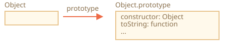
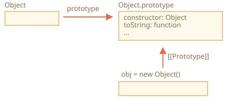
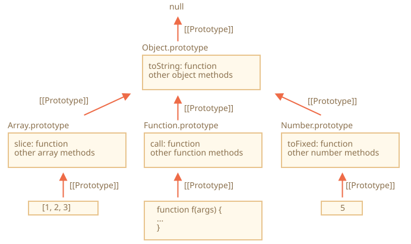
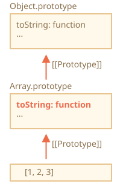

# โปรโตไทป์มาตรฐาน (native prototypes)

คอนสตรักเตอร์ (constructor) ที่ JavaScript มีให้ เช่น `Object` และ `Array` ก็ใช้พร็อพเพอร์ตี้ (property) ชื่อ `"prototype"` เช่นเดียวกับคอนสตรักเตอร์ที่เราเขียนเอง

ลองดูกันว่าออบเจ็กต์ (object) มาตรฐานได้ความสามารถต่าง ๆ มาจากโปรโตไทป์อย่างไร แล้วเราจะใช้โปรโตไทป์เพิ่มความสามารถให้ออบเจ็กต์เหล่านี้ได้อย่างไร

## Object.prototype

ลองส่งออบเจ็กต์ว่างให้ `alert`

```js run
let obj = {};
alert( obj ); // "[object Object]" ?
```

`alert` แสดงสตริง (string) `"[object Object]"` เพราะตอนแปลง `obj` เป็นสตริง JavaScript เรียกเมธอด (method) `toString` แต่เราไม่ได้เขียนเมธอดนี้ไว้ใน `obj` แล้วมันมาจากไหน?

การสร้างออบเจ็กต์ด้วย `{}` ให้ผลเหมือนกับการเรียก `new Object()` คอนสตรักเตอร์ `Object` มีพร็อพเพอร์ตี้ `prototype` ชี้ไปที่ออบเจ็กต์ที่เก็บเมธอด `toString` และเมธอดอื่น ๆ

ในภาพ ออบเจ็กต์ที่เก็บเมธอดเหล่านี้คือ `Object.prototype`



เมื่อเราเขียน `new Object()` หรือสร้างออบเจ็กต์ด้วย `{}` ออบเจ็กต์ที่ได้จะมี `Object.prototype` เป็น `[[Prototype]]` ตามหลักที่ได้เรียนในบทก่อน



เมื่อเรียก `obj.toString()` แล้วไม่พบ `toString` บน `obj` เอง JavaScript จึงตามไปพบเมธอดบน `Object.prototype`

ลองเปรียบเทียบดูว่า `toString` ที่อ่านผ่านแต่ละทางเป็นเมธอดเดียวกันไหม

```js run
let obj = {};

alert(obj.__proto__ === Object.prototype); // true

alert(obj.toString === obj.__proto__.toString); //true
alert(obj.toString === Object.prototype.toString); //true
```

เมื่อไล่ตามห่วงโซ่โปรโตไทป์ (prototype chain) ของ `obj` ในตัวอย่าง ออบเจ็กต์ตัวสุดท้ายที่พบคือ `Object.prototype` เพราะ `[[Prototype]]` ของมันเป็น `null`

```js run
alert(Object.prototype.__proto__); // null
```

## โปรโตไทป์มาตรฐานอื่น ๆ [#other-built-in-prototypes]

ออบเจ็กต์ที่สร้างด้วยคอนสตรักเตอร์มาตรฐานอื่น ๆ อย่าง `Array`, `Date` และ `Function` ก็สืบทอดเมธอดจากโปรโตไทป์เช่นกัน

ตัวอย่างเช่น อาร์เรย์ (array) `[1, 2, 3]` มี `Array.prototype` เป็นโปรโตไทป์ เช่นเดียวกับอาร์เรย์ที่สร้างด้วย `new Array()` อาร์เรย์แต่ละตัวจึงใช้เมธอดชุดเดียวกันได้โดยไม่ต้องเก็บสำเนาแยกกัน ช่วยประหยัดหน่วยความจำ

เมื่อตามห่วงโซ่โปรโตไทป์ของออบเจ็กต์มาตรฐานเหล่านี้ขึ้นไป เราจะพบ `Object.prototype` เป็นออบเจ็กต์ตัวสุดท้าย นี่คือที่มาของคำพูดที่ว่า “ทุกอย่างสืบทอดมาจากออบเจ็กต์”

ในภาพ `Array.prototype`, `Function.prototype` และ `Number.prototype` ต่างมีเมธอดของตัวเอง แต่ทั้งสามสืบทอดจาก `Object.prototype` ตัวเดียวกัน



ลองไล่ตามโปรโตไทป์ของอาร์เรย์ทีละขั้น

```js run
let arr = [1, 2, 3];

// สืบทอดมาจาก Array.prototype?
alert( arr.__proto__ === Array.prototype ); // true

// แล้วต่อไปจาก Object.prototype?
alert( arr.__proto__.__proto__ === Object.prototype ); // true

// บนสุดคือ null
alert( arr.__proto__.__proto__.__proto__ ); // null
```

เมธอดบนโปรโตไทป์ต่างตัวกันอาจมีชื่อเดียวกัน เช่น `Array.prototype` มี `toString` ของตัวเอง ซึ่งคืนค่าสตริงที่คั่นสมาชิกแต่ละตัวด้วยจุลภาค

```js run
let arr = [1, 2, 3]
alert(arr); // 1,2,3 <-- ผลลัพธ์จาก Array.prototype.toString
```

แม้ว่า `Object.prototype` จะมี `toString` เช่นกัน แต่เมื่อค้นหาจากอาร์เรย์ JavaScript จะพบ `toString` บน `Array.prototype` ก่อน จึงใช้เมธอดนั้น





ในคอนโซล (console) ของเบราว์เซอร์ (browser) เช่น Chrome เราดูได้ว่าออบเจ็กต์สืบทอดมาจากไหน ลองพิมพ์ `console.dir([1, 2, 3])` จะเห็นสมาชิกทั้งสามกับ `length` บนอาร์เรย์ เมื่อขยายดูโปรโตไทป์ จะพบเมธอดของ `Array.prototype` แล้วจึงถึง `Object.prototype`

![|alt="ผลของ console.dir([1,2,3]) แสดงสมาชิกสามตัวและ length บนอาร์เรย์ เมื่อขยายโปรโตไทป์จะพบ Array.prototype แล้วจึงพบ Object.prototype"](console_dir_array.png)

ฟังก์ชัน (function) ก็เป็นออบเจ็กต์และสืบทอดจาก `Function.prototype` เช่นกัน เมธอด `call` และ `apply` ที่เราใช้กับฟังก์ชันมาจากที่นั่น และ `Function.prototype` ก็มี `toString` ของตัวเองด้วย

```js run
function f() {}

alert(f.__proto__ == Function.prototype); // true
alert(f.__proto__.__proto__ == Object.prototype); // true, สืบทอดมาจากออบเจ็กต์
```

## ค่าพื้นฐาน (primitive) [#-primitives]

แล้วสตริง ตัวเลข (number) และบูลีน (boolean) มีเมธอดให้เรียกได้อย่างไร ในเมื่อทั้งสามชนิดเป็นค่าพื้นฐาน?

เมื่อเราอ่านพร็อพเพอร์ตี้ของค่าเหล่านี้ JavaScript ทำงานเสมือนว่าสร้างออบเจ็กต์ห่อหุ้ม (wrapper object) ของชนิด `String`, `Number` หรือ `Boolean` ขึ้นมาชั่วคราว เราจึงเรียกเมธอดได้ เมื่อใช้งานเสร็จก็ไม่ต้องใช้ออบเจ็กต์นั้นอีก

นี่คือพฤติกรรมที่ข้อกำหนดของภาษาระบุไว้ เอนจิน (engine) อาจให้ผลเดียวกันได้โดยไม่ต้องสร้างออบเจ็กต์ชั่วคราวขึ้นมาจริง ๆ ส่วนเมธอดที่เรียกนั้นอยู่บน `String.prototype`, `Number.prototype` และ `Boolean.prototype` ตามชนิดของค่า

```warn header="ค่า `null` และ `undefined` ไม่มีออบเจ็กต์ห่อหุ้ม"
`null` และ `undefined` ไม่มีออบเจ็กต์ห่อหุ้มหรือโปรโตไทป์ที่คู่กัน เราจึงอ่านพร็อพเพอร์ตี้หรือเรียกเมธอดบนสองค่านี้ไม่ได้
```

## การแก้ไขโปรโตไทป์มาตรฐาน [#native-prototype-change]

เราเพิ่มเมธอดลงในโปรโตไทป์มาตรฐานได้ เช่น ถ้าเพิ่ม `show` ลงใน `String.prototype` สตริงทุกตัวก็จะเรียก `show()` ได้

```js run
String.prototype.show = function() {
  alert(this);
};

"BOOM!".show(); // BOOM!
```

เวลาอยากให้สตริงทุกตัวมีเมธอดใหม่ เราอาจนึกถึงวิธีนี้ แต่การแก้โปรโตไทป์มาตรฐานส่งผลถึงโค้ดส่วนอื่นด้วย

```warn
โค้ดที่ทำงานร่วมกันใช้โปรโตไทป์มาตรฐานร่วมกันด้วย ถ้าไลบรารี (library) สองตัวเพิ่มเมธอดชื่อ `show` ให้ `String.prototype` เหมือนกัน ตัวที่กำหนดทีหลังจะเขียนทับเมธอดของตัวแรก

ด้วยเหตุนี้ โดยทั่วไปจึงควรหลีกเลี่ยงการแก้โปรโตไทป์มาตรฐาน
```

**ข้อยกเว้นคือการเพิ่มเมธอดมาตรฐานที่เอนจินยังขาดอยู่ วิธีนี้เรียกว่า polyfilling**

เมธอดที่เราเขียนขึ้นมาทดแทนเรียกว่า polyfill โดยต้องทำงานตามที่ข้อกำหนดของ JavaScript ระบุไว้สำหรับเมธอดนั้น

เราจึงตรวจดูก่อนว่าเอนจินมีเมธอดอยู่แล้วหรือยัง ถ้ายังไม่มีจึงเพิ่มเมธอดที่เขียนเองลงในโปรโตไทป์

ตัวอย่างนี้แสดงแนวคิดด้วยเมธอด `repeat` แบบย่อ

```js run
if (!String.prototype.repeat) { // ถ้ายังไม่มีเมธอดนี้
  // เพิ่มเข้าไปในโปรโตไทป์

  String.prototype.repeat = function(n) {
    // ทำซ้ำสตริง n ครั้ง

    // จริงๆ แล้วโค้ดควรจะซับซ้อนกว่านี้อีกนิด
    // (อัลกอริทึมเต็มอยู่ในสเปก)
    // แต่ polyfill ที่ไม่สมบูรณ์ก็มักจะใช้งานได้ดีพอ
    return new Array(n + 1).join(this);
  };
}

alert( "La".repeat(3) ); // LaLaLa
```


## การยืมเมธอด (method borrowing) จากโปรโตไทป์ [#-2]

เราเคยเห็นการยืมเมธอดมาแล้วในบท <info:call-apply-decorators#method-borrowing>

เรายืมเมธอดได้โดยนำเมธอดของออบเจ็กต์หนึ่งไปกำหนดเป็นพร็อพเพอร์ตี้ของอีกออบเจ็กต์ แล้วเรียกเมธอดผ่านออบเจ็กต์นั้น

เมธอดบนโปรโตไทป์มาตรฐานหลายตัวก็นำไปใช้แบบนี้ได้

เช่น ถ้าเรามีออบเจ็กต์ที่คล้ายอาร์เรย์ (array-like object) เราอาจอยากใช้เมธอดบางตัวของอาร์เรย์กับออบเจ็กต์นั้น

ลองยืม `join` มาใช้กับ `obj`

```js run
let obj = {
  0: "Hello",
  1: "world!",
  length: 2,
};

*!*
obj.join = Array.prototype.join;
*/!*

alert( obj.join(',') ); // Hello,world!
```

`join` อ่านพร็อพเพอร์ตี้ `length` แล้วอ่านสมาชิกตามดัชนี (index) โดยไม่ตรวจว่าออบเจ็กต์ที่เรียกเมธอดเป็นอาร์เรย์จริงหรือไม่ ในตัวอย่างนี้ `obj` มี `length` เท่ากับ `2` และมีสมาชิกที่ดัชนี `0` กับ `1` จึงได้สตริง `Hello,world!` เมธอดมาตรฐานอื่นอีกหลายตัวก็ใช้กับออบเจ็กต์ลักษณะนี้ได้

อีกวิธีหนึ่งคือกำหนด `obj.__proto__` ให้ชี้ไปที่ `Array.prototype` แล้ว `obj` จะสืบทอดเมธอดของอาร์เรย์มาใช้ได้ทั้งหมด

แต่ถ้า `obj` ต้องสืบทอดจากออบเจ็กต์ตัวเดิมอยู่ เราจะเพิ่ม `Array.prototype` เป็นโปรโตไทป์โดยตรงอีกตัวไม่ได้ เพราะออบเจ็กต์มีโปรโตไทป์โดยตรงได้ทีละตัวเท่านั้น

การยืมเมธอดจึงยืดหยุ่นกว่า เราเลือกเมธอดจากหลายออบเจ็กต์มาใช้ร่วมกันได้โดยยังใช้โปรโตไทป์เดิม

## สรุป [#-3]

- ออบเจ็กต์มาตรฐานที่เราเห็นในตัวอย่างใช้หลักเดียวกัน
    - เมธอดที่ใช้ร่วมกันอยู่บนโปรโตไทป์ เช่น `Array.prototype`, `Object.prototype` และ `Date.prototype`
    - ออบเจ็กต์แต่ละตัวเก็บข้อมูลของตัวเอง เช่น สมาชิกของอาร์เรย์ ค่าของพร็อพเพอร์ตี้ หรือวันเวลา
- ค่าพื้นฐานอย่างตัวเลข สตริง และบูลีน เรียกเมธอดจากโปรโตไทป์ของออบเจ็กต์ห่อหุ้มได้ นั่นคือ `Number.prototype`, `String.prototype` และ `Boolean.prototype` ตามลำดับ มีเพียง `undefined` กับ `null` ที่ไม่มีออบเจ็กต์ห่อหุ้ม
- เราแก้หรือเพิ่มเมธอดบนโปรโตไทป์มาตรฐานได้ แต่โดยทั่วไปควรทำเฉพาะเมื่อต้องเพิ่ม polyfill สำหรับเมธอดที่มีในมาตรฐานแล้วและเอนจินยังไม่รองรับ
