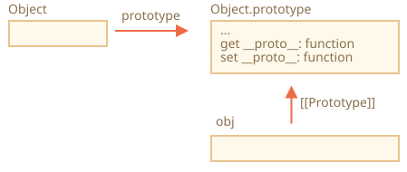
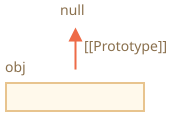

# จัดการโปรโตไทป์ (prototype) และสร้างออบเจ็กต์ (object) ที่ไม่มี __proto__

ในบทแรกเราใช้ `__proto__` เพื่อดูว่าออบเจ็กต์สืบทอดจากไหน และเปลี่ยนให้ออบเจ็กต์หนึ่งสืบทอดจากอีกตัวได้ คราวนี้เราจะทำสองอย่างนั้นด้วยเมธอด (method) ของ `Object`

การอ่านหรือเขียนผ่าน `obj.__proto__` เป็นวิธีเก่าที่เบราว์เซอร์ (browser) ยังรองรับเพื่อให้โค้ดเดิมทำงานได้ เมื่อเขียนโค้ดใหม่ให้ใช้เมธอดต่อไปนี้

- [Object.getPrototypeOf(obj)](mdn:js/Object/getPrototypeOf) คืนค่า `[[Prototype]]` ของ `obj`
- [Object.setPrototypeOf(obj, proto)](mdn:js/Object/setPrototypeOf) เปลี่ยน `[[Prototype]]` ของ `obj` ให้เป็น `proto`

ถ้ารู้ตั้งแต่ตอนสร้างว่าจะให้ออบเจ็กต์สืบทอดจากไหน เราเขียน `{ __proto__: ... }` ได้เลย เมื่อเขียนออบเจ็กต์ด้วยวงเล็บปีกกาแบบนี้ (object literal) ไวยากรณ์ของภาษาจะกำหนดโปรโตไทป์ให้โดยตรง จึงไม่ต้องอาศัย setter ที่สืบทอดมา

อีกวิธีหนึ่งคือใช้ `Object.create`

- [Object.create(proto[, descriptors])](mdn:js/Object/create) สร้างออบเจ็กต์ว่างที่มี `proto` เป็น `[[Prototype]]` ถ้าต้องการเพิ่มพร็อพเพอร์ตี้ (property) ตั้งแต่ตอนสร้าง ก็ระบุรายละเอียดของแต่ละพร็อพเพอร์ตี้ (property descriptor) ได้ด้วย

ลองสร้าง `rabbit` ที่สืบทอดจาก `animal` แล้วตรวจดูว่าโปรโตไทป์ของ `rabbit` คือ `animal` จริงไหม

```js run
let animal = {
  eats: true
};

// สร้างออบเจ็กต์ใหม่โดยมี animal เป็นโปรโตไทป์
*!*
let rabbit = Object.create(animal); // เหมือนกับ {__proto__: animal}
*/!*

alert(rabbit.eats); // true

*!*
alert(Object.getPrototypeOf(rabbit) === animal); // true
*/!*

*!*
Object.setPrototypeOf(rabbit, {}); // เปลี่ยนโปรโตไทป์ของ rabbit เป็น {}
*/!*
```

อาร์กิวเมนต์ (argument) ตัวที่สองของ `Object.create` เป็นออบเจ็กต์ที่ระบุได้ว่าอยากเพิ่มพร็อพเพอร์ตี้ชื่ออะไรบ้าง และแต่ละชื่อมีรายละเอียดอย่างไร จะละอาร์กิวเมนต์ตัวนี้ก็ได้

ในตัวอย่างนี้ `rabbit` สืบทอดจาก `animal` และมี `jumps` เป็นของตัวเอง โดยเริ่มต้นด้วยค่า `true`

```js run
let animal = {
  eats: true
};

let rabbit = Object.create(animal, {
  jumps: {
    value: true
  }
});

alert(rabbit.jumps); // true
```

เราระบุรายละเอียดของแต่ละพร็อพเพอร์ตี้ในรูปแบบเดียวกับที่เห็นในบท <info:property-descriptors>

ถ้าต้องการคัดลอกออบเจ็กต์โดยเก็บรายละเอียดเหล่านี้ไว้ด้วย การวน `for..in` แล้วคัดลอกทีละค่าจะเก็บได้ไม่ครบ เราใช้ `Object.create` แบบนี้ได้

```js
let clone = Object.create(
  Object.getPrototypeOf(obj), Object.getOwnPropertyDescriptors(obj)
);
```

สำเนานี้มีโปรโตไทป์เดียวกับ `obj` และมีพร็อพเพอร์ตี้ของตัวเองครบเหมือนต้นฉบับ ไม่ว่า `for..in` จะมองเห็นชื่อนั้นหรือข้ามไป พร็อพเพอร์ตี้ที่เก็บค่าโดยตรง (data property) ก็ยังเก็บค่าเดิม ส่วนพร็อพเพอร์ตี้ที่อ่านหรือเขียนผ่าน getter หรือ setter ก็ยังเรียกใช้ฟังก์ชัน (function) เดิม การคัดลอกนี้เป็นแบบตื้น (shallow copy) ถ้าค่าที่เก็บไว้เป็นออบเจ็กต์ ทั้งสองฝั่งจะยังอ้างถึงออบเจ็กต์ตัวเดียวกัน


## ประวัติย่อ [#brief-history]

ทำไม JavaScript จึงมีวิธีกำหนดและอ่าน `[[Prototype]]` หลายแบบ?

JavaScript ใช้การสืบทอดผ่านโปรโตไทป์ (prototypal inheritance) มาตั้งแต่แรก แต่วิธีที่ผู้เขียนโค้ดใช้จัดการกับโปรโตไทป์ค่อย ๆ เปลี่ยนไป

- เดิมที ถ้าต้องการสร้างออบเจ็กต์ให้สืบทอดจากออบเจ็กต์ที่กำหนด เราใช้พร็อพเพอร์ตี้ `prototype` ของฟังก์ชันคอนสตรักเตอร์ (constructor function) แล้วเรียกด้วย `new`
- ในปี 2009 มาตรฐาน ECMAScript 5 เพิ่ม `Object.create` สำหรับกำหนดโปรโตไทป์ตอนสร้าง และ `Object.getPrototypeOf` สำหรับอ่านโปรโตไทป์ แต่ยังไม่มีเมธอดมาตรฐานสำหรับเปลี่ยนโปรโตไทป์ภายหลัง บางเบราว์เซอร์รองรับ `obj.__proto__` ให้อ่านและเปลี่ยนโปรโตไทป์ได้อยู่แล้ว
- ในปี 2015 มาตรฐาน ECMAScript เพิ่ม `Object.setPrototypeOf` เพื่อให้เปลี่ยนโปรโตไทป์ได้ และระบุพฤติกรรมของ `Object.prototype.__proto__` ที่เบราว์เซอร์ใช้อยู่ไว้ในภาคผนวก B ส่วนสภาพแวดล้อมอื่นจะรองรับหรือไม่ก็ได้
- ในมาตรฐานปี 2022 ไวยากรณ์ `{ __proto__: ... }` เป็นส่วนหนึ่งของข้อกำหนดหลักแล้ว ส่วน getter และ setter ของ `Object.prototype.__proto__` ก็ย้ายมาอยู่ในข้อกำหนดหลักเช่นกัน โดยยังจัดเป็นกลไกเก่าสำหรับโค้ดเดิม (legacy) ในมาตรฐานปี 2026 เบราว์เซอร์ต้องรองรับ getter และ setter คู่นี้ ส่วนสภาพแวดล้อมอื่นเลือกได้ว่าจะรองรับหรือไม่

แล้วทำไมเวลาอ่านหรือเปลี่ยนโปรโตไทป์จึงแนะนำให้ใช้ `Object.getPrototypeOf` และ `Object.setPrototypeOf`?

ความแตกต่างจะเห็นชัดเมื่อเราใช้ออบเจ็กต์เก็บข้อมูลที่ผู้ใช้ตั้งชื่อเอง ลองดูตัวอย่างในหัวข้อถัดไป

```warn header="ถ้าความเร็วสำคัญ ควรกำหนด `[[Prototype]]` ตั้งแต่ตอนสร้างออบเจ็กต์"
โดยปกติเรารู้ตั้งแต่ต้นว่าอยากให้ `rabbit` สืบทอดจาก `animal` จึงกำหนดโปรโตไทป์ครั้งเดียวตอนสร้าง `rabbit` ได้เลย

เอนจิน JavaScript (JavaScript engine) อาศัยการที่ห่วงโซ่โปรโตไทป์ (prototype chain) คงเดิมเพื่อให้อ่านพร็อพเพอร์ตี้ได้เร็ว การเปลี่ยนโปรโตไทป์ภายหลังด้วย `Object.setPrototypeOf` หรือ `obj.__proto__ = ...` อาจทำให้โค้ดที่อ่านพร็อพเพอร์ตี้ช้าลงด้วย จึงควรเปลี่ยนเมื่อจำเป็นและยอมรับผลด้านความเร็วได้
```

## ใช้ออบเจ็กต์ที่ไม่มีโปรโตไทป์เก็บข้อมูลตามชื่อ [#very-plain]

เราใช้ออบเจ็กต์เป็นที่เก็บข้อมูลแบบจับคู่ชื่อกับค่า (associative array) ได้ โดยใช้ชื่อหรือคีย์ (key) เพื่อเรียกดูค่าที่เก็บไว้

สมมติว่าเรากำลังทำพจนานุกรมและให้*ผู้ใช้พิมพ์คีย์เอง* จะเกิดอะไรขึ้นถ้าผู้ใช้พิมพ์ `"__proto__"`?

```js run
let obj = {};

let key = prompt("What's the key?", "__proto__");
obj[key] = "some value";

alert(obj[key]); // [object Object] ไม่ใช่ "some value"!
```

ถ้าผู้ใช้พิมพ์ `__proto__` บรรทัด `obj[key] = "some value"` จะไม่เก็บค่านั้นไว้ พออ่านกลับมา `alert` จึงแสดง `[object Object]`

สาเหตุคือ `obj` สืบทอด setter ของ `__proto__` มา เมื่อเราเขียนคีย์ชื่อนี้ setter จะรับเฉพาะออบเจ็กต์หรือ `null` เป็นโปรโตไทป์ใหม่ จึงข้ามค่าสตริง (string) ที่ส่งให้ ส่วนการอ่านคีย์เดียวกันจะได้โปรโตไทป์เดิมกลับมา

สำหรับคนใช้พจนานุกรม นี่คือข้อผิดพลาด เพราะเมื่ออ่านคีย์ใด ก็ควรได้ค่าที่เก็บไว้สำหรับคีย์นั้น

ถ้าข้อมูลที่เก็บเป็นออบเจ็กต์ การเขียนคีย์ชื่อนี้อาจเปลี่ยนโปรโตไทป์จริง ๆ และทำให้โปรแกรมอ่านค่าที่สืบทอดมาต่างจากเดิม

ข้อผิดพลาดลักษณะนี้สังเกตได้ยาก และอาจส่งผลต่อความปลอดภัยของโปรแกรม โดยเฉพาะเมื่อใช้ JavaScript ฝั่งเซิร์ฟเวอร์

ชื่ออื่นก็อาจชนกับสิ่งที่ออบเจ็กต์สืบทอดมา เช่น ถ้าเก็บข้อมูลใน `obj.toString` ข้อมูลนั้นจะบังเมธอด `toString` เดิม

แล้วเราจะเก็บคีย์ที่ผู้ใช้เลือกเองได้อย่างไร?

วิธีหนึ่งคือใช้ `Map` ซึ่งแยกคีย์ที่เก็บด้วย `set` ออกจากชื่อเมธอดของมัน คีย์ `"__proto__"` จึงใช้เก็บและอ่านค่าได้ตามปกติ

```js run
let map = new Map();

let key = prompt("What's the key?", "__proto__");
map.set(key, "some value");

alert(map.get(key)); // "some value" (ตามที่ตั้งใจไว้)
```

ถ้าต้องการใช้ไวยากรณ์สั้น ๆ อย่าง `obj[key]` ก็ยังใช้ออบเจ็กต์ได้

ลองดูว่า `__proto__` มาจากไหน ออบเจ็กต์ที่สร้างด้วย `{}` สืบทอดพร็อพเพอร์ตี้ที่มี getter และ setter (accessor property) ชื่อนี้มาจาก `Object.prototype`



เมื่ออ่าน `obj.__proto__` เรากำลังเรียก getter ที่สืบทอดมาเพื่ออ่าน `[[Prototype]]` ของ `obj` เมื่อเขียนค่าให้ชื่อนี้ก็จะเรียก setter เพื่อเปลี่ยน `[[Prototype]]`

ดังนั้น `__proto__` กับ `[[Prototype]]` จึงทำหน้าที่ต่างกัน ชื่อแรกเป็นทางให้อ่านหรือเปลี่ยนค่า ส่วนชื่อหลังคือช่องภายในที่เก็บโปรโตไทป์ของออบเจ็กต์

ถ้าเราเริ่มด้วยออบเจ็กต์ที่ไม่มีโปรโตไทป์ ก็จะไม่มี getter หรือ setter ที่สืบทอดมาให้ชื่อคีย์ไปชน ลองสร้างด้วย `Object.create(null)`

```js run
*!*
let obj = Object.create(null);
// หรือ: obj = { __proto__: null }
*/!*

let key = prompt("What's the key?", "__proto__");
obj[key] = "some value";

alert(obj[key]); // "some value"
```

ออบเจ็กต์ที่ได้จาก `Object.create(null)` เริ่มต้นโดยไม่มีพร็อพเพอร์ตี้ของตัวเอง และมี `[[Prototype]]` เป็น `null`



คราวนี้เมื่อเขียน `obj[key]` โดยใช้คีย์ `"__proto__"` ออบเจ็กต์จะสร้างพร็อพเพอร์ตี้เก็บข้อมูลชื่อนั้นขึ้นมา เมื่ออ่านกลับมาก็ได้ค่า `"some value"` ที่เพิ่งเก็บไว้

ออบเจ็กต์แบบนี้มีเรียกกันว่า *very plain object* หรือ *pure dictionary* เพราะแม้แต่พร็อพเพอร์ตี้ที่ออบเจ็กต์ธรรมดาอย่าง `{}` สืบทอดมาก็ไม่มีติดมาด้วย

ผลอีกอย่างคือ ออบเจ็กต์นี้ไม่ได้รับเมธอดมาตรฐานอย่าง `toString` เมื่อ `alert` พยายามแปลงออบเจ็กต์เป็นสตริงจึงเกิดข้อผิดพลาด

```js run
*!*
let obj = Object.create(null);
*/!*

alert(obj); // Error (ไม่มี toString)
```

ถ้าเราใช้ออบเจ็กต์นี้เพื่อเก็บและอ่านค่าตามคีย์อย่างเดียว การไม่มี `toString` ก็มักไม่เป็นปัญหา

เรายังใช้เมธอดที่เรียกผ่าน `Object` ได้ เช่น `Object.keys(obj)` เพราะเมธอดนี้รับ `obj` เป็นอาร์กิวเมนต์ จึงใช้ได้แม้ `obj` จะไม่ได้สืบทอดเมธอดใดเลย


```js run
let chineseDictionary = Object.create(null);
chineseDictionary.hello = "你好";
chineseDictionary.bye = "再见";

alert(Object.keys(chineseDictionary)); // hello,bye
```

## สรุป [#-2]

- ในบทนี้เราใช้สองวิธีเพื่อกำหนดโปรโตไทป์ตั้งแต่ตอนสร้างออบเจ็กต์

    - เขียน `{ __proto__: ... }` และระบุพร็อพเพอร์ตี้อื่นในวงเล็บปีกกาคู่เดียวกัน
    - เรียก [Object.create(proto[, descriptors])](mdn:js/Object/create) และระบุรายละเอียดของพร็อพเพอร์ตี้ที่ต้องการเพิ่มได้

    ถ้าต้องการสำเนาแบบตื้นที่ใช้โปรโตไทป์เดิมและมีรายละเอียดของพร็อพเพอร์ตี้ครบ ให้ส่งทั้งสองอย่างให้ `Object.create`

    ```js
    let clone = Object.create(Object.getPrototypeOf(obj), Object.getOwnPropertyDescriptors(obj));
    ```

- ถ้าต้องการอ่านหรือเปลี่ยนโปรโตไทป์ของออบเจ็กต์ที่มีอยู่แล้ว ให้ใช้เมธอดของ `Object`

    - [Object.getPrototypeOf(obj)](mdn:js/Object/getPrototypeOf) คืนค่า `[[Prototype]]` ของ `obj` เช่นเดียวกับการอ่านผ่าน getter ของ `__proto__`
    - [Object.setPrototypeOf(obj, proto)](mdn:js/Object/setPrototypeOf) เปลี่ยน `[[Prototype]]` ของ `obj` เป็น `proto` เช่นเดียวกับการกำหนดโปรโตไทป์ผ่าน setter ของ `__proto__`

- สำหรับโค้ดใหม่ ควรใช้เมธอดทั้งสองนี้แทน getter และ setter แบบเดิมของ `Object.prototype.__proto__`

- ถ้าต้องการเก็บข้อมูลตามคีย์ที่ผู้ใช้ป้อน ให้สร้างออบเจ็กต์ที่ไม่มีโปรโตไทป์ด้วย `Object.create(null)` หรือ `{ __proto__: null }`

    เมื่อไม่มีโปรโตไทป์ ก็ใช้ชื่ออย่าง `__proto__` และ `toString` เก็บค่าได้เหมือนคีย์อื่น ๆ

    ส่วนออบเจ็กต์ธรรมดาจะสืบทอดทั้งเมธอดและพร็อพเพอร์ตี้ที่มี getter หรือ setter มาจาก `Object.prototype` จึงต้องระวังเมื่อคีย์ที่ใช้ตรงกับชื่อที่สืบทอดมา
